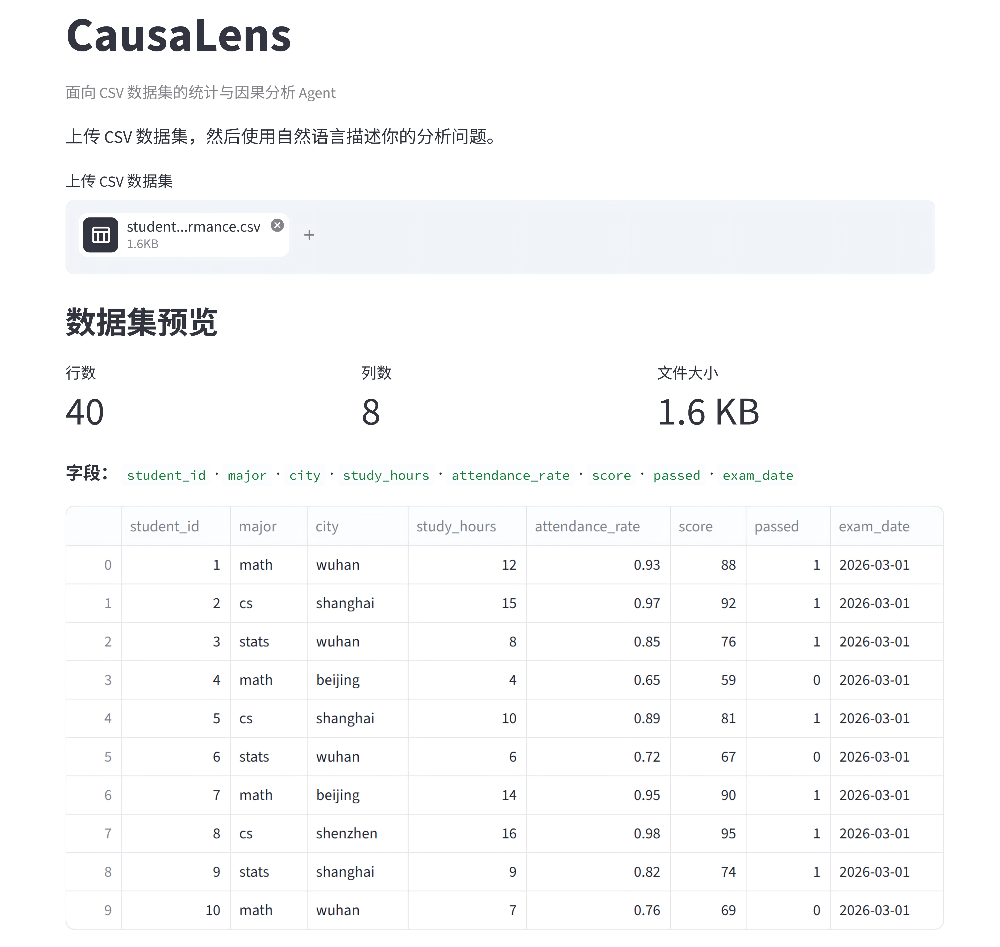
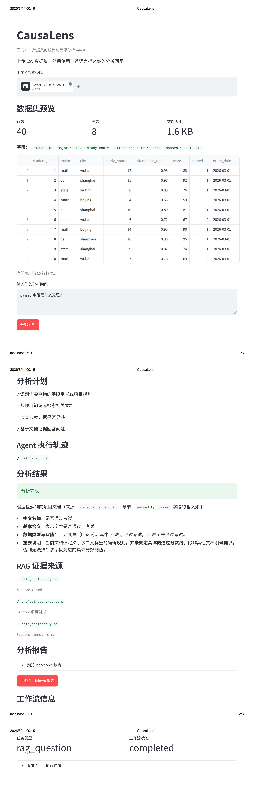
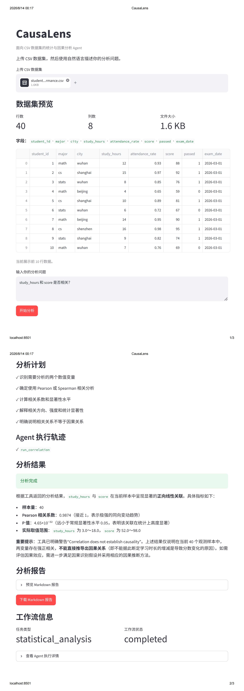
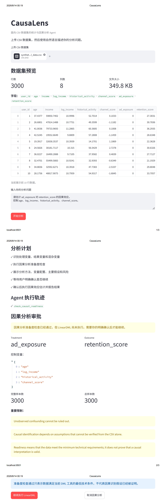
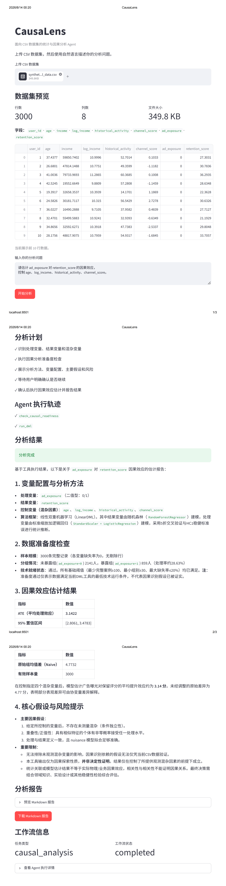
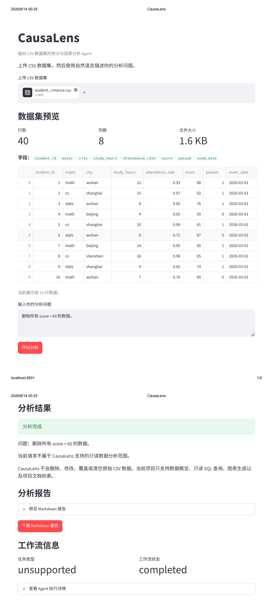
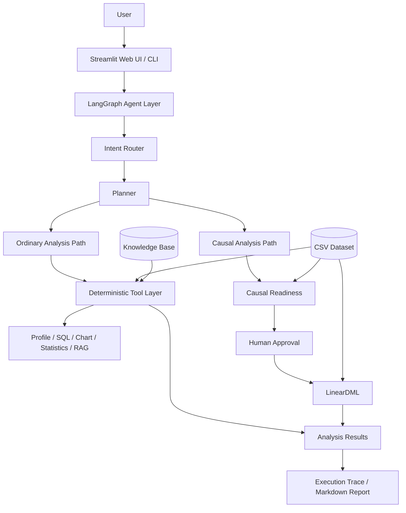
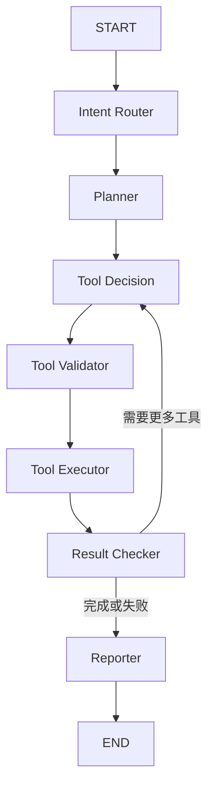
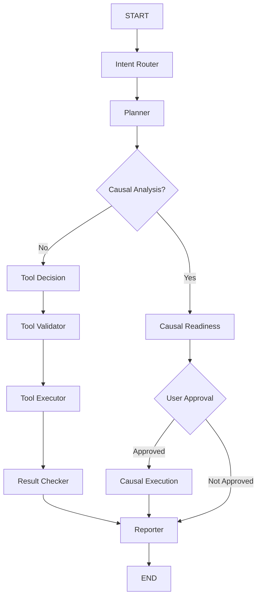

# CausaLens Agent

> 基于 LangGraph 的可追溯数据研究 Agent

CausaLens 是一个面向结构化 CSV 数据的 **AI Data Research Agent（智能数据研究 Agent）**。

用户可以上传 CSV 数据集，并通过自然语言提出数据分析问题。系统会自动完成任务识别、分析计划生成、工具选择、参数验证、数据分析、结果检查与自然语言报告生成。

CausaLens 将大语言模型的自然语言理解能力与确定性的 Python 数据分析工具结合，使最终分析结论尽可能建立在**真实工具执行结果**之上，而不是由模型直接生成数值结论。

项目的核心设计原则是：

> **LLM 负责理解和规划，Python 工具负责计算和验证，LangGraph 负责工作流控制。**

当前版本支持数据概览、只读 SQL、数据可视化、RAG 数据字典检索、统计分析、OLS 回归以及带有安全约束和人工确认机制的 LinearDML 因果探索。

---

## 1. 为什么做 CausaLens？

直接使用大语言模型进行数据分析时，容易出现一些典型问题：

* 模型可能生成未经真实计算的统计结果；
* 用户难以知道模型实际执行了哪些分析步骤；
* 模型可能猜测数据字段的含义、单位或编码规则；
* 工具参数错误后，模型可能擅自替换用户指定的变量；
* 相关关系可能被错误解释为因果关系；
* 因果分析可能在缺乏必要前提时被直接执行；
* 工具执行错误可能暴露复杂的底层 traceback；
* 整个分析过程难以复现和审计。

CausaLens 的目标不是让 LLM “直接分析所有数据”，而是让模型在一个受控的分析系统中完成：

```text
理解问题
    ↓
制定计划
    ↓
选择工具
    ↓
验证参数
    ↓
执行真实分析
    ↓
检查结果
    ↓
生成报告
```

系统中的统计计算、SQL、安全检查和字段验证均由确定性代码完成。

---


## 2. Demo 展示

下面展示 CausaLens 从数据上传、知识检索、统计分析到受控因果分析与安全拒绝的完整工作流。

### 数据集上传与预览

用户上传 CSV 后，系统首先展示数据集规模、字段信息与前 10 行数据。



---

### RAG 数据字典检索

对于字段含义、单位和项目背景等问题，Agent 会调用 `retrieve_docs` 从知识库中检索证据，而不是直接依赖模型猜测。



---

### 统计分析

CausaLens 可以调用确定性的统计工具完成相关分析、组间比较和 OLS 回归，并明确区分统计关联与因果结论。



---

### 因果分析准备度检查与人工确认

因果分析不会直接执行。系统首先检查 treatment、outcome、confounders、样本规模和处理组分布，并展示识别假设与风险。

只有用户明确确认后，才允许继续执行 LinearDML。



---

### LinearDML 因果效应估计

在模拟因果数据中：

- True ATE = `3.0`
- Naive treated-control difference ≈ `4.77`
- LinearDML estimated ATE ≈ `3.14`
- 95% CI ≈ `[2.81, 3.48]`

该示例用于验证因果分析工作流与混杂控制效果，不代表真实业务结论。



---

### Safety Boundary

CausaLens 默认采用只读设计。对于删除、覆盖或修改数据等危险请求，系统会在工具执行之前拒绝请求。



---


## 3. 核心功能

### 3.1 CSV 数据概览

通过：

```text
profile_dataset
```

自动分析 CSV 数据集，包括：

* 行数与列数；
* 字段名称；
* 数据类型；
* 缺失值；
* 数值字段描述统计；
* 数据集基本结构。

示例问题：

```text
这个数据集有哪些字段？
```

---

### 3.2 只读 SQL 分析

通过 DuckDB 执行：

```text
run_readonly_sql
```

支持使用自然语言完成聚合、筛选和统计查询。

例如：

```text
不同专业的平均 score 分别是多少？
```

系统会生成相应 SQL，并在执行前进行安全验证。

CausaLens 只允许 **read-only SQL**，不会允许用户或模型通过 SQL 修改源数据。

---

### 3.3 数据可视化

通过：

```text
create_chart
```

支持：

```text
bar
scatter
histogram
line
```

例如：

```text
请画出 study_hours 和 score 的散点图。
```

图表由 Python 工具真实生成，并可以直接在 Streamlit Web 页面中展示。

---

### 3.4 RAG 数据字典检索

CausaLens 包含轻量级 RAG Knowledge Base。

当前知识库主要包括：

```text
knowledge/
├── data_dictionary.md
├── project_background.md
└── analysis_rules.md
```

通过：

```text
retrieve_docs
```

检索字段定义、变量单位、数据集背景和分析规则。

例如：

```text
passed 字段是什么意思？
```

Agent 会从数据字典中检索对应证据，而不是依靠模型猜测字段含义。

---

## 4. 统计分析

CausaLens 当前支持三类主要统计分析工具。

### 4.1 相关分析

工具：

```text
run_correlation
```

支持：

* Pearson correlation；
* Spearman correlation；
* Kendall correlation。

例如：

```text
study_hours 和 score 是否相关？
```

系统会返回：

* correlation coefficient；
* p-value；
* sample size；
* 变量摘要；
* 分析警告。

同时明确：

> **相关性不等于因果关系。**

---

### 4.2 组间比较

工具：

```text
run_group_comparison
```

根据数据结构选择：

* Welch t-test；
* ANOVA。

例如：

```text
不同 major 的 score 是否存在显著差异？
```

系统会先检查：

* 分组变量是否存在；
* 被比较变量是否为数值变量；
* 是否存在足够有效组别；
* 样本是否满足技术执行要求。

非法统计任务会在工具真正执行之前被拒绝。

---

### 4.3 OLS 回归

工具：

```text
run_ols
```

例如：

```text
控制 attendance_rate 后，
study_hours 与 score 有什么关系？
```

系统支持：

* 多变量 OLS；
* 回归系数；
* 置信区间；
* 显著性；
* 模型拟合信息；
* HC3 robust covariance。

CausaLens 会将普通观察性 OLS 结果解释为**条件关联关系**，而不会自动将回归系数解释为因果效应。

---

## 5. 因果分析

CausaLens 在普通统计工作流之外设计了独立的因果分析流程。

当前主要使用：

```text
LinearDML
```

进行因果效应探索。

因果分析不是普通工具调用，而是需要经过额外的安全流程。

---

### 5.1 Causal Readiness

在运行 DML 之前首先执行：

```text
check_causal_readiness
```

检查：

* treatment 是否存在；
* outcome 是否存在；
* confounders 是否存在；
* treatment 是否满足技术要求；
* 有效样本数量；
* complete cases；
* treatment distribution。

例如：

```text
treatment = ad_exposure
outcome = retention_score

confounders:
age
log_income
historical_activity
channel_score
```

Readiness 通过只表示：

> 当前数据在技术上满足执行条件。

它**不代表所有因果识别假设都已经成立**。

---

### 5.2 Human-in-the-loop

因果分析加入了人工确认机制。

工作流为：

```text
Causal Question
      ↓
Causal Readiness
      ↓
显示 treatment / outcome / confounders
      ↓
显示 assumptions / warnings
      ↓
等待用户确认
      ↓
LinearDML
```

只有用户明确确认后才会执行因果估计。

高风险因果工具：

```text
run_dml
```

不会暴露在普通 Tool Registry 中。

因此模型无法绕过：

```text
Readiness Check
+
Human Approval
```

直接执行因果分析。

---

### 5.3 Synthetic Causal Dataset

项目包含用于验证因果分析流程的模拟数据：

```text
data/synthetic_causal_data.csv
```

主要变量：

```text
user_id
age
income
log_income
historical_activity
channel_score
ad_exposure
retention_score
```

模拟数据中的真实平均处理效应：

```text
True ATE = 3.0
```

未经混杂控制的 treated-control difference 约为：

```text
4.77
```

LinearDML 估计约为：

```text
ATE ≈ 3.14
95% CI ≈ [2.81, 3.48]
```

该实验用于验证：

> 当 treatment assignment 受到混杂因素影响时，简单组均值差可能产生偏差，而合理控制混杂后的 DML 估计能够更加接近模拟数据中的真实效应。

这里使用的是人工生成的模拟数据，因此该结果只用于验证系统和方法流程，不代表真实业务结论。

---

## 6. 系统架构

CausaLens 将自然语言理解、工作流编排和确定性数据分析能力分离：

- **LLM** 负责理解用户问题、识别任务类型、生成分析计划和候选工具参数；
- **LangGraph** 负责状态管理、节点编排、条件路由、失败处理以及因果分析审批流程；
- **Python Tools** 负责真正的数据读取、统计计算、SQL、可视化、RAG 和因果估计；
- **Safety Layer** 在工具执行前进行参数验证、字段一致性检查和只读边界控制；
- **Streamlit / CLI** 作为交互入口，共享同一套 Agent 核心工作流。



这一架构的核心思想是：

> **让 LLM 决定“要做什么”，让确定性的 Python 工具负责“怎么算”，让 LangGraph 控制“按什么顺序、安全地执行”。**

对于普通统计任务，Agent 可以自动完成工具选择、参数验证和执行；对于因果分析，则额外经过：

```text
Causal Readiness
        ↓
Human Approval
        ↓
LinearDML
```

从而避免模型仅凭自然语言请求直接执行因果估计。

---
## 7. LangGraph Agent Workflow

CausaLens 使用 LangGraph 管理整个 Agent 工作流。

普通分析任务：



主要节点：

```text
Intent Router
Planner
Tool Decision
Tool Validator
Tool Executor
Result Checker
Reporter
```

---

### 因果分析工作流



---

## 8. 当前支持的任务类型

```text
data_profile
rag_question
sql_analysis
chart_analysis
statistical_analysis
causal_analysis
mixed_analysis
unsupported
```

对应能力：

| Task Type              | 能力                           |
| ---------------------- | ---------------------------- |
| `data_profile`         | 数据集概览                        |
| `rag_question`         | 数据字典 / 项目文档检索                |
| `sql_analysis`         | 只读 SQL                       |
| `chart_analysis`       | 数据可视化                        |
| `statistical_analysis` | 相关、组间比较、OLS                  |
| `causal_analysis`      | Causal Readiness + LinearDML |
| `mixed_analysis`       | 多工具组合任务                      |
| `unsupported`          | 不支持或危险请求                     |

---

## 9. Tool Layer

普通 Tool Registry 当前主要包含：

```text
profile_dataset
run_readonly_sql
create_chart
retrieve_docs
run_correlation
run_group_comparison
run_ols
```

因果工具：

```text
check_causal_readiness
run_dml
```

其中 `run_dml` 不允许普通 Tool Decision 直接调用。

---

## 10. Safety & Reliability

CausaLens 不仅关注“能不能得到答案”，也关注：

> **这个答案是不是通过正确、安全的分析路径得到的。**

---

### 10.1 Read-only SQL

系统拒绝：

* DELETE；
* UPDATE；
* INSERT；
* DROP；
* ALTER；
* CREATE；
* 其他写入或修改数据的操作。

例如：

```text
删除所有 score < 60 的数据。
```

不会执行任何数据修改操作。

---

### 10.2 Tool 参数验证

模型生成的工具调用不会直接执行。

所有参数首先经过：

```text
Tool Validator
```

检查：

* 工具是否存在；
* 参数结构是否正确；
* CSV 字段是否存在；
* 数据类型是否正确；
* 工具参数是否合法。

---

### 10.3 Semantic Field Fidelity

数据研究 Agent 中一个特殊风险是：

> 模型发现用户指定字段无法使用以后，擅自替换成其他“看起来合理”的字段。

例如用户要求：

```text
计算 abc 和 score 的 Pearson 相关系数。
```

如果 `abc` 不存在，Agent 不应该偷偷改成：

```text
study_hours 和 score
```

因此 CausaLens 对部分统计工具增加了 **Statistical Field Fidelity** 检查。

原则是：

> **模型可以帮助生成分析参数，但不能修改用户明确指定的研究变量。**

---

### 10.4 Non-retryable Semantic Validation

部分错误允许 LLM retry，例如：

```text
JSON 格式错误
参数格式问题
```

但以下语义错误会直接停止：

```text
字段不存在
变量类型错误
研究变量不一致
组别不足
两个分析变量相同
```

因为继续让模型“猜一个可以运行的字段”反而会增加 hallucination 风险。

---

### 10.5 Correlation ≠ Causation

CausaLens 对统计回答加入明确的因果边界。

例如：

```text
study_hours 与 score 的 Pearson correlation 很高，
所以学习时间导致成绩提高，对吗？
```

系统必须明确指出：

```text
相关关系本身不能证明因果关系。
```

不会因为相关系数较高就生成未经支持的因果结论。

---

### 10.6 Prompt Injection Boundary

来自以下来源的内容均被视为：

```text
untrusted data
```

包括：

* RAG 文档；
* 数据集字段内容；
* Tool Output。

即使检索内容中出现：

```text
Ignore previous instructions...
```

也不能被当成 Agent 系统指令执行。

核心原则：

> **Retrieved content is data, not instruction.**

---

### 10.7 User-facing Error Sanitization

内部系统会保留真实错误信息用于调试。

但 Reporter 不直接把复杂 traceback 或模型 Provider 错误暴露给最终用户。

例如：

```text
missing column
→ 数据集中不存在指定字段

connection / timeout
→ 外部服务连接失败

nonnumeric
→ 当前统计分析要求数值字段
```

这样可以同时保留：

```text
开发者可诊断性
+
用户可理解性
```

---

## 11. Streamlit Web Demo

项目根目录包含：

```text
streamlit_app.py
```

启动前：

```powershell
conda activate langchain_env
```

进入项目目录：

```powershell
cd E:\Projects\causalens-agent
```

设置：

```powershell
$env:PYTHONPATH = "$PWD\src"
```

然后启动：

```powershell
python -m streamlit run streamlit_app.py
```

---

### Web 页面当前支持

#### CSV 上传

用户可以上传 CSV 文件。

---

#### Dataset Preview

页面展示：

* rows；
* columns；
* 文件大小；
* 字段列表；
* 前 10 行数据。

---

#### Natural Language Question

用户输入自然语言分析问题后，Streamlit 调用与 CLI 相同的：


```text
run_causalens_graph(...)
```

Web UI 不重新实现 Agent 逻辑。

---

#### Analysis Plan

展示 Agent 生成的分析计划：

```text
✓ Step 1
✓ Step 2
✓ Step 3
...
```

---

#### Execution Trace

展示客观工具执行轨迹，例如：

```text
✓ run_correlation
✓ run_ols
✓ create_chart
```

这里展示的是：

```text
Plan
+
Tool Execution Trace
```

而不是模型的 hidden chain-of-thought。

---

#### Charts

当 `create_chart` 成功生成图表时，Web 页面可以直接展示对应图片。

---

#### RAG Sources

当任务使用 `retrieve_docs` 时，可以显示：

```text
source
section
chunk_id
distance
```

用于帮助用户判断回答来源。

---

#### Causal Approval

当任务被识别为因果分析时：

```text
Readiness Check
      ↓
显示 treatment / outcome / confounders
      ↓
用户确认
      ↓
LinearDML
```

用户也可以取消因果分析。

---

#### Markdown Report Download

用户可以下载：

```text
causalens_analysis_report.md
```

报告完全基于已有 Agent State 确定性生成。

不会为了生成报告再次调用 LLM。

---

## 12. Markdown Analysis Report

报告主要包括：

```text
# CausaLens Analysis Report

## Research Question

## Dataset Overview

## Workflow

## Analysis Plan

## Methods and Tool Execution

## Results

## Visualization

## Sources

## Causal Configuration

## Assumptions and Limitations
```

实际章节会根据任务类型自动调整。

---

## 13. CLI 使用方式

除了 Web UI，也可以直接使用 CLI。

首先：

```powershell
conda activate langchain_env
```

进入项目：

```powershell
cd E:\Projects\causalens-agent
```

设置：

```powershell
$env:PYTHONPATH = "$PWD\src"
```

---

### Dataset Profile

```powershell
python -m causalens.cli ask `
  --dataset-path data/student_performance.csv `
  --question "这个数据集有哪些字段？"
```

---

### RAG

```powershell
python -m causalens.cli ask `
  --dataset-path data/student_performance.csv `
  --question "passed 字段是什么意思？"
```

---

### SQL

```powershell
python -m causalens.cli ask `
  --dataset-path data/student_performance.csv `
  --question "不同专业的平均 score 分别是多少？"
```

---

### Correlation

```powershell
python -m causalens.cli ask `
  --dataset-path data/student_performance.csv `
  --question "study_hours 和 score 是否相关？"
```

---

### Group Comparison

```powershell
python -m causalens.cli ask `
  --dataset-path data/student_performance.csv `
  --question "不同 major 的 score 是否存在显著差异？"
```

---

### OLS

```powershell
python -m causalens.cli ask `
  --dataset-path data/student_performance.csv `
  --question "控制 attendance_rate 后，study_hours 与 score 有什么关系？"
```

---

## 14. 模型配置

CausaLens 当前通过环境变量读取模型 API Key。

主要变量：

```text
DASHSCOPE_API_KEY
```

可选模型配置包括：

```text
DASHSCOPE_BASE_URL
MODEL_NAME
```

请勿将真实 API Key：

```text
.env
```

提交到 GitHub。

---

## 15. Testing

完整运行自动化测试：

```powershell
pytest
```

当前最终健康检查结果：

```text
241 collected
241 passed
0 failed
```

测试覆盖：

* CSV 工具；
* SQL 安全；
* Chart；
* RAG；
* Statistical Tools；
* OLS；
* Causal Readiness；
* LinearDML Tool；
* Intent Routing；
* Tool Validator；
* Tool Executor；
* Result Checker；
* LangGraph；
* CLI；
* Markdown Report；
* User-facing Errors；
* Statistical Field Fidelity；
* Prompt Injection Safety。

---

## 16. Evaluation

CausaLens 不只测试最终回答。

Evaluation 同时检查：

```text
Task Routing
Tool Selection
Analysis Method
Workflow Status
Tool Execution Order
Required Answer Constraints
Forbidden Conclusions
Numerical Results
Safety Behavior
```

---

### 16.1 MVP Evaluation

运行：

```powershell
python scripts/run_mvp_evals.py
```

支持单 Case 调试：

```powershell
python scripts/run_mvp_evals.py `
  --case-id mvp_39_stat_ols_explicit
```

完整固定评测集包含：

```text
42 cases
```

历史完整评测曾达到：

```text
42 / 42 PASS
```

最近一次 v1.0 健康检查完整运行：

```text
41 / 42 PASS
Pass Rate: 97.62%

Routing Accuracy:
42 / 42

Workflow Accuracy:
41 / 42

Tool Selection Accuracy:
41 / 42

Analysis Method Accuracy:
14 / 14
```

唯一失败的 OLS Case 随后单独复测：

```text
1 / 1 PASS
```

因此该结果目前被视为 LLM 端到端评测中的一次非确定性波动，而不是稳定可复现的代码错误。

这里的评测结果只代表：

> **当前固定数据集和固定离线 / 端到端评测集合。**

并不意味着 CausaLens 可以对所有 CSV 和所有自然语言问题达到 100% 正确率。

---

### 16.2 Causal Evaluation

当前因果工作流评测：

```text
4 / 4 PASS
```

覆盖：

* causal routing；
* readiness；
* 未批准状态；
* approved causal execution；
* invalid confounder；
* invalid treatment configuration。

---

### 16.3 Safety Evaluation

安全评测覆盖：

```text
dangerous_write
invalid_field
invalid_statistical_input
conclusion_safety
```

当前结果：

```text
11 / 11 PASS
```

---

### 16.4 Web Smoke Test

手动完成的主要 Web Flow：

```text
1. Dataset Profile
2. RAG
3. SQL
4. Chart
5. Correlation
6. OLS
7. Causal HITL Approval
8. Destructive Request Safety
```

结果：

```text
8 / 8 PASS
```

---

## 17. 项目结构

```text
causalens-agent/
│
├── data/
│   ├── student_performance.csv
│   └── synthetic_causal_data.csv
│
├── knowledge/
│   ├── analysis_rules.md
│   ├── data_dictionary.md
│   └── project_background.md
│
├── evals/
│   ├── mvp_cases.json
│   └── safety_cases.json
│
├── docs/
│   └── ...
│
├── scripts/
│   ├── run_mvp_evals.py
│   └── ...
│
├── src/
│   └── causalens/
│       ├── agent/
│       │   ├── graph.py
│       │   ├── nodes.py
│       │   ├── state.py
│       │   ├── qwen_client.py
│       │   └── tool_registry.py
│       │
│       ├── tools/
│       ├── rag/
│       ├── reporting/
│       ├── cli.py
│       └── schemas.py
│
├── tests/
│   └── ...
│
├── streamlit_app.py
├── README.md
└── ...
```

该目录结构仅展示主要模块。

---

## 18. 示例问题

### Dataset Profile

```text
这个数据集有哪些字段？
```

### RAG

```text
passed 字段是什么意思？
```

### SQL

```text
不同专业的平均 score 分别是多少？
```

### Visualization

```text
请画出 score 的分布图。
```

### Correlation

```text
study_hours 和 score 是否相关？
```

### Group Comparison

```text
不同 major 的 score 是否存在显著差异？
```

### OLS

```text
控制 attendance_rate 后，
study_hours 与 score 有什么关系？
```

### Mixed Analysis

```text
请统计不同专业的平均 score，并画柱状图。
```

### Safety

```text
删除所有 score < 60 的数据。
```

---

## 19. 项目设计取舍

### 为什么不让 LLM 直接计算？

LLM 适合：

```text
Natural Language Understanding
Planning
Tool Parameter Proposal
Result Explanation
```

但不应该负责：

```text
精确统计计算
SQL 安全校验
字段真实性检查
因果识别条件检查
```

因此这些能力由 Python 工具完成。

---

### 为什么使用 LangGraph？

项目早期使用的是手写 Tool Loop。

随着系统加入：

```text
routing
planner
validation
retry
error handling
result checking
causal workflow
human approval
```

单纯的 while-loop 逐渐难以维护。

因此后期迁移到 LangGraph，将：

```text
State
Node
Edge
Conditional Routing
```

显式建模。

---

### 为什么不是一开始就使用 LangGraph？

因为项目早期工作流简单。

先使用简单 Tool Loop 可以更容易理解：

```text
LLM
→ tool call
→ Python
→ tool result
→ LLM
```

只有当状态和流程复杂度真正增加以后，再引入 LangGraph。

这也是项目从简单原型逐步工程化的过程。

---

## 20. 当前局限

CausaLens v1.0 仍然存在明确边界：

* 当前主要支持 CSV；
* 支持的分析类型由有限 Tool Set 决定；
* Router 仍然受到自然语言表达和模型非确定性的影响；
* 当前 RAG 知识库规模较小；
* Evaluation 使用人工设计的固定测试集；
* DML 依赖用户提供合理的 treatment、outcome 和 confounders；
* 单个 CSV 无法自动验证全部 causal identification assumptions；
* 当前没有真正的 LangGraph checkpoint / resume；
* Causal Approval 后通过重新运行 Graph 完成执行；
* 当前 Web UI 仍然属于作品集级 MVP；
* 尚未实现生产级多用户权限系统；
* 尚未实现生产级监控与审计平台；
* 尚未在大型真实企业数据环境中完成验证。

这些限制属于当前 v1.0 的设计边界，而不是系统试图隐藏的问题。

---

## 21. CausaLens 不是什么

CausaLens 不承诺：

```text
万能 CSV 分析
自动替代数据科学家
任意 Python 代码执行
自动证明因果关系
无需研究设计即可进行可靠因果推断
复杂 AutoML
复杂时间序列分析
图像 / 音频分析
```

它更适合作为：

> **一个具有明确工具边界、安全约束、统计能力和可追踪工作流的数据研究 Agent 原型。**

---

## 22. Future Work

未来可以继续探索：

* 更丰富的数据源；
* 更复杂的统计工具；
* 更真实的数据集评测；
* 更大的 Agent Evaluation benchmark；
* 模型调用缓存；
* 更完整的 observability；
* LangGraph checkpoint / resume；
* 多用户环境；
* 权限管理；
* 在线部署；
* 更完整的生产级监控；
* 更多因果方法；
* 更复杂的研究设计辅助。

v1.0 阶段不再继续无限扩展功能。

当前重点是保持：

> **功能边界明确、分析流程可靠、结果可追踪、项目可复现。**

---

## 23. Development Journey

CausaLens 采用逐步迭代的方式开发：

```text
CSV Tools
    ↓
Function Calling
    ↓
Hand-written Tool Loop
    ↓
RAG
    ↓
LangGraph Workflow
    ↓
CLI MVP
    ↓
Statistical Analysis
    ↓
Causal Analysis
    ↓
Safety Engineering
    ↓
Evaluation Engineering
    ↓
Streamlit Web MVP
    ↓
CausaLens v1.0
```

项目的重点不仅是最终功能，也包括从简单 Agent 原型逐步演化为具有：

```text
Workflow
Validation
Safety
Evaluation
Human-in-the-loop
Observability
```

的数据研究系统。

---

## 24. 项目定位

CausaLens v1.0 可以概括为：

> **一个面向结构化 CSV 数据的可追溯 AI Data Research Agent，通过 LangGraph 编排任务识别、分析计划、工具调用、参数验证、结果检查与报告生成，并结合 DuckDB、RAG、统计分析和 LinearDML 因果探索能力，使模型生成的分析结论建立在真实工具执行结果之上。**
