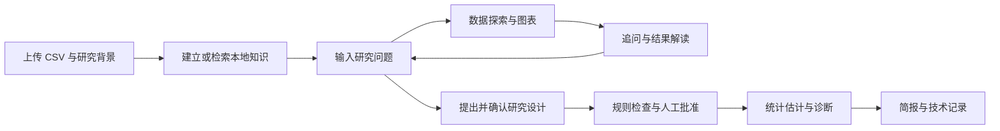
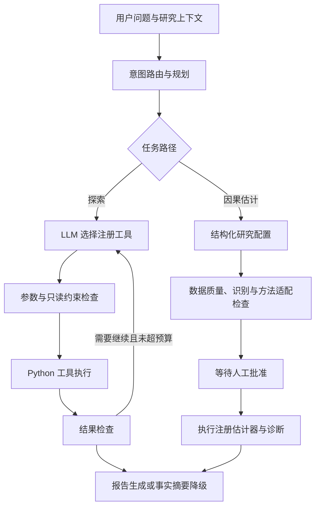

# CausaLens Agent

**面向结构化数据的因果分析探索 Agent：检索研究背景、调用统计工具、辅助研究设计，在人工确认后执行估计。**

从“这两列有什么关系？”到“怎样研究其中的因果影响？”，CausaLens 将自然语言探索与明确的研究配置连接起来。模型负责提出计划和解释结果，Python 工具负责计算，规则检查与人工审批决定哪些估计可以执行。

[快速开始](#快速开始) · [演示指南](docs/CURRENT_DEMO.md) · [Agent 工作流](#agent-如何工作) · [方法能力](#可以执行哪些分析)

## 当前网页是什么样的？

默认入口是 **对话探索工作台**。首页不再使用早期单轮表单和 LinearDML 演示截图：旧截图保留在 `docs/images/` 作为历史素材，不代表现在的界面。

| 网页区域 | 用户可以做什么 |
| --- | --- |
| 左侧「1. 研究资料」 | 上传 CSV、补充背景、选择匹配案例知识、确认模型访问范围 |
| 「2. 建立本数据知识库」 | 将背景和字段结构保存为当前数据版本的本地知识库，查看检索模式与片段 |
| 「3. 现在问助手」 | 在可见的多行输入框提问，点击「发送并开始探索」 |
| 本轮结果 | 阅读解释、计算事实和图表；展开计划、工具执行与引用依据 |
| 后续提问 | 继续调用工具探索，或选择「只解读上一轮结果（不执行工具）」 |
| 研究设计与人工配置 | 核对 AI 方法候选、变量与研究背景，检查后批准执行 |
| 报告导出 | 下载用户简报、完整技术记录和研究会话 JSON |

顶部还提供 **研究设计与人工配置** 和 **快速论文演示（不调用模型）** 两个入口。后者是固定配置的备用演示，不代表模型自主规划。



## 为什么是 Agent 项目？

- **工具调用**：模型在受限工具集中选择数据概览、只读 SQL、绘图、统计分析和背景检索；数值来自真实工具结果。
- **多轮研究上下文**：按数据 SHA256 隔离会话，带入最近三轮记录；支持只解释已有结果而不重新计算。
- **背景增强**：用户背景、数据结构、版本匹配的案例资料和方法卡参与规划，保留来源供核对。
- **人工审批**：对话工作台执行已检查的固定配置快照；批准后不重新让模型选择变量，历史批准不沿用到新任务。
- **失败处理**：报告模型失败时展示工具事实摘要，标明 AI 解读未完成，保留图表和工具记录。
- **可追溯性**：计划、工具参数与结果、研究配置及引用可供检查；用户简报与技术记录分开。

这是 **LLM 与确定性规则协作的有界工作流**。意图路由、参数校验、方法适配和执行权限不是完全交给模型决定；它不会自动证明因果关系。

## 快速开始

使用 **Python 3.12**，依赖版本见 [requirements.txt](requirements.txt)。

```powershell
git clone https://github.com/shanyinduo-glitch/causalens-agent.git
cd causalens-agent
python -m venv .venv
.\.venv\Scripts\Activate.ps1
python -m pip install -r requirements.txt
python -m pip install -e . --no-deps
```

在启动网页的同一个终端设置模型环境变量：

```powershell
$env:DASHSCOPE_API_KEY = "你的 API Key"
$env:MODEL_NAME = "你的百炼账户可调用的模型 ID"
$env:DASHSCOPE_TIMEOUT_SECONDS = "60"
$env:CAUSALENS_MAX_LLM_CALLS_PER_RUN = "6"
python -m streamlit run streamlit_app.py --server.port 8504
```

打开 `http://localhost:8504`。系统直接读取环境变量，**不会自动加载 .env 文件**；[.env.example](.env.example) 用于说明配置项。模型权限、价格与额度以服务商账户为准。

若之前设置过 `FREE_MODEL_CANDIDATES`，它优先于 `MODEL_NAME`。SDK 隐式重试已禁用；仅在明确识别为免费额度耗尽的响应时尝试列表中的下一模型，超时不会自动轮换。

### 无需私有数据的第一轮演示

上传仓库自带的 [student_performance.csv](data/student_performance.csv)，在「你的问题」输入：

> 请检查 study_hours 和 score 的缺失情况与描述统计，绘制两者的散点图。只描述统计关联，不执行因果估计；不要替换变量。

结果返回后，选择「只解读上一轮结果（不执行工具）」：

> 请解释刚才的结果，以及为什么不能据此认定学习时间导致成绩提高。不要重新计算。

再切回「继续探索／提出新分析」：

> 请比较不同 major 的 score，并绘制各专业平均分柱状图。说明各组样本量和结论限制，不做因果解释。

完整步骤和验收标准见 [当前版本演示指南](docs/CURRENT_DEMO.md)。

## Agent 如何工作



主要实现：[LangGraph 编排](src/causalens/agent/graph.py)、[工作流节点](src/causalens/agent/nodes.py)、[对话工作台](src/causalens/ui/research_workspace.py)、[契约运行器](src/causalens/causal/contract_runner.py)。

## 可以执行哪些分析？

| 路径 | 当前能力 | 使用边界 |
| --- | --- | --- |
| 数据探索 | 描述统计、缺失检查、只读 SQL、柱状图／散点图／直方图／折线图 | 无需为了画图声明处理变量和混杂变量 |
| 统计分析 | 相关分析、组间比较、OLS | 统计关联不自动解释为因果效应 |
| 横截面二元处理 | AIPW、LinearDML、CausalForestDML | 明确调整集；CATE 还需处理前效应修饰变量 |
| 政策与面板设计 | 两期 DiD、Event Study、错位处理时点 DiD | 需相应时间、分组和单位字段及研究假设 |
| 其他研究设计 | IV、RDD、合成控制 | 需显式提供工具变量、阈值或处理单位等依据 |
| 单条时间序列 | Local Projection，单期或累计动态响应，HAC 标准误 | 需时间字段与滞后设定；不能由相关性推定冲击外生 |
| 方法比较候选 | 连续处理 DML、协整等方法知识 | 当前不是可执行的连续 DML／协整估计路径 |

各方法依赖对应设计的字段与检查，并非上传任意 CSV 后都能使用。普通探索工具与因果执行器分开注册，模型不能通过一般工具调用绕过审批。

## 背景知识与 RAG

| 知识来源 | 实际实现 |
| --- | --- |
| 当前数据集知识库 | 用户背景与字段结构按数据哈希本地保存；优先向量检索，嵌入模型不可用时降级为明确标注的词项检索 |
| 黄金论文案例 | 校验值匹配后使用整理过的数据字典、论文摘述及风险说明；不是整篇论文 PDF 的语义检索 |
| 因果方法卡 | 人工整理的目标、假设、诊断与来源，作为紧凑上下文提供给模型；不称为向量检索 |
| 通用资料 | `knowledge/` 下的数据字典与分析规则，可通过 `retrieve_docs` 检索 |

引用编号存在不等于内容支持结论，草案结构检查不等于语义正确。方法可执行状态来自本地能力表，不能由模型自行承诺。

## 黄金与 TIPS 案例

展示链路：**变量理解 → 背景检索 → LP 与连续 DML 方法比较 → 人工确认 → 动态响应与局限解释**。

- `t_diff`：10 年期 TIPS 实际收益率变化；`y_ret`：黄金对数收益率；时间字段为 `date`。
- 当前系统用 LP 研究多期动态响应；毕业论文的连续处理 DML 回答不同参数目标，不能直接按显著性比较优劣。
- 上游仍有月份匹配、发布日期和删行后时间间隔风险；案例用于探索与工作流展示，不作为已识别因果效应的证明。
- 真实 CSV 不随仓库发布。公开保留 [案例说明](docs/case_studies/gold_tips_thesis/README.md)、[字段字典](docs/case_studies/gold_tips_thesis/data_dictionary.md) 和 [配置示例](examples/case_studies/gold_tips_thesis/lp_core.json)。

没有黄金数据也能使用公开示例演示工具调用与审批流程；不能把其他 CSV 当作已核验的黄金版本。

## 验证与复现

```powershell
python -m pip install -r requirements-dev.txt
python -m pytest -q --basetemp=tmp/pytest
```

测试覆盖研究配置、字段与方法路由、估计器、诊断、报告、模型错误和网页交互。测试中的模型替身不代表真实 API 可用；实际联调还取决于网络、权限与响应格式。

2026-10-31 本地记录：全量 509 项中 508 项通过，1 项网页测试触发默认 3 秒启动超时；预加载模块后重跑该测试文件，3 项全部通过。这是本地验证记录，非持续集成状态徽章。

## 项目结构

```text
streamlit_app.py             网页入口
src/causalens/
  agent/                    LangGraph、工具注册、模型客户端与预算
  ui/                       对话工作台、研究设计、知识库与方法卡
  causal/                   研究契约、适配、识别检查与执行
  tools/                    数据探索、统计与各类估计工具
  rag/                      通用资料检索
  reporting/                用户简报、技术报告与降级摘要
data/                       公开示例；private/ 不提交
examples/                   可核对的研究配置示例
tests/                      单元、集成与网页交互测试
docs/                       演示与案例说明
```

## 当前边界

- 对话记录保存在网页会话中，可导出；不是生产级持久对话或分布式断点恢复。
- 工具摘要可能含样例或分组信息，需用户确认后才交给所配置模型服务。
- 模型仍可能误解字段或写出不准确的方法说明；计算事实、来源与配置必须可核对。
- 统计调整、安慰剂检验和稳健标准误都不能自动建立因果识别。
- 当前为作品集级研究原型，未实现生产级多租户权限和大规模服务监控。

技术栈：**Python · LangGraph · OpenAI-compatible API · Streamlit · DuckDB · Chroma · pandas · statsmodels · EconML**。
