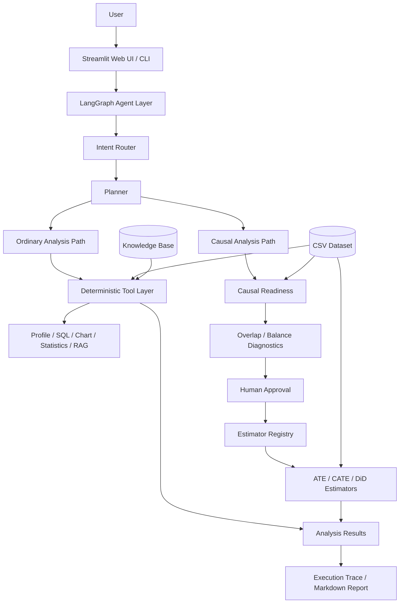
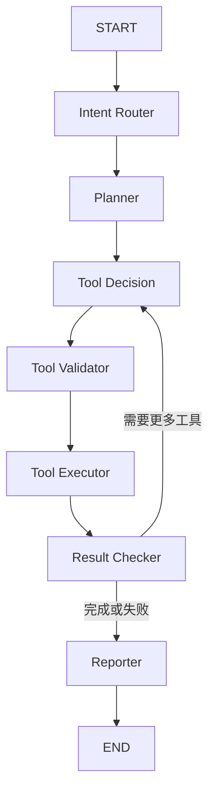
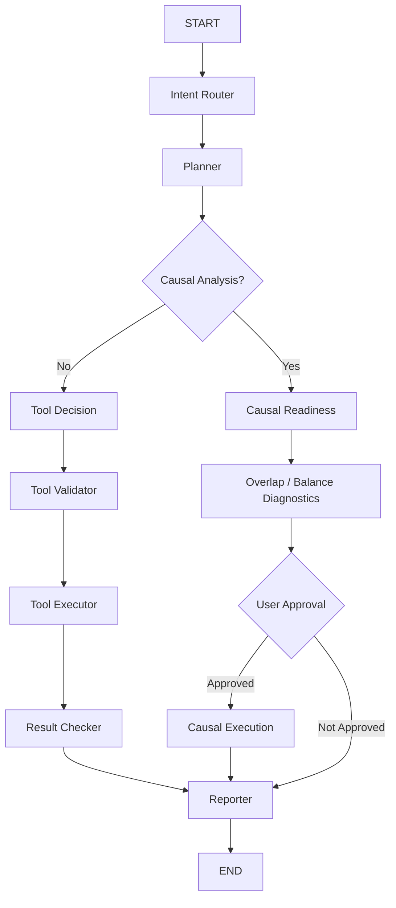

# CausaLens Agent

> 融合 RAG 与统计工具调用的因果分析探索 Agent

CausaLens 是一个面向结构化 CSV 数据的**因果分析探索研究 Agent**：结合领域背景与方法知识，通过交互澄清、数据探索和统计工具调用，辅助用户形成研究方案，并在人工确认后执行支持的因果分析、解释结果与识别局限。

用户可以从“数据呈现什么差异”开始，也可以直接提出“某个因素是否影响结果”。描述统计、组间比较和绘图用于理解数据与发现研究线索；它们不是因果证明，也不要求每次探索都进入因果估计。研究方案仍需用户确认，缺少识别依据时只报告探索性结果或阻止执行。

### 如何使用当前入口

- **自由提问**：通过自然语言请求数据概览、组间比较、绘图或背景检索，先探索研究线索。
- **快速引导**：结合方法知识与可选的案例背景检索生成 AI 候选方案，经澄清、人工配置和检查后执行支持的估计器。
- **专业契约**：直接提交明确的研究配置。
- **快速论文演示**：不调用模型的固定案例演示，不代表 Agent 自主规划。

默认入口为**对话探索工作台**：按数据文件校验值隔离会话，携带最近三轮研究记录，调用已有的有预算、有工具步数上限的 LangGraph 工作流。支持继续探索和只解读已有结果；因果估计批准针对已检查的固定快照，不重新规划。精确的候选方法比较与配置保留在“研究设计与人工配置”。用户可把研究背景与当前数据集结构建立为按数据 SHA256 隔离的本地知识库；机器无法加载嵌入模型时自动降级为可审计的中文词项检索。它不是毕业论文全文语义检索，也不会在用户未授权时把背景发送给模型。

### 工作台展示流程

1. 上传非敏感 CSV，确认模型访问范围，补充字段含义或选择匹配案例背景。
2. 提出带真实字段名的比较、绘图或研究问题，查看工具返回的图表与解释。
3. 选择“只解读上一轮结果”追问限制（一次模型请求，不运行统计工具），或继续探索提出新任务。
4. 因果任务只有在准备度检查通过并展示方案后才允许人工批准；审批执行同一快照。
5. 下载客户简报、完整技术记录和会话 JSON。失败不自动重试，不把历史批准沿用到新任务。

会话历史保存在当前网页会话中，非永久记忆；可导出 JSON 保存。工具摘要可能包含样例或分组数据，上传前须确认数据可用于所配置模型服务。模型自由文本仍可能出错，数值以工具结果为准。

CausaLens 将大语言模型的自然语言理解能力与确定性的 Python 数据分析工具结合，使最终分析结论尽可能建立在**真实工具执行结果**之上，而不是由模型直接生成数值结论。

项目的核心设计原则是：

> **LLM 负责理解和规划，Python 工具负责计算和验证，LangGraph 负责工作流控制。**

当前版本支持数据概览、只读 SQL、数据可视化、RAG 数据字典检索、统计分析、OLS 回归，以及带有识别检查、诊断、人工确认和多估计器稳健性比较的因果探索。

---

## 1. 为什么做 CausaLens？

直接使用大语言模型进行数据分析时，容易出现一些典型问题：

* 模型可能生成未经真实计算的统计结果；
* 用户难以知道模型实际执行了哪些分析步骤；
* 模型可能猜测数据字段的含义、单位或编码规则；
* 工具参数错误后，模型可能擅自替换用户指定的变量；
* 相关关系可能被错误解释为因果关系；
* 因果分析可能在缺乏必要前提时被直接执行；
* 工具执行错误可能暴露复杂的底层 traceback；
* 整个分析过程难以复现和审计。

CausaLens 的目标不是让 LLM “直接分析所有数据”，而是让模型在一个受控的分析系统中完成：

```text
理解问题
    ↓
制定计划
    ↓
选择工具
    ↓
验证参数
    ↓
执行真实分析
    ↓
检查结果
    ↓
生成报告
```

系统中的统计计算、SQL、安全检查和字段验证均由确定性代码完成。

---


## 2. Demo 展示

下面展示 CausaLens 从数据上传、知识检索、统计分析到受控因果分析与安全拒绝的完整工作流。

### 数据集上传与预览

用户上传 CSV 后，系统首先展示数据集规模、字段信息与前 10 行数据。


---

### RAG 数据字典检索

对于字段含义、单位和项目背景等问题，Agent 会调用 `retrieve_docs` 从知识库中检索证据，而不是直接依赖模型猜测。


---

### 统计分析

CausaLens 可以调用确定性的统计工具完成相关分析、组间比较和 OLS 回归，并明确区分统计关联与因果结论。


---

### 因果分析准备度检查与人工确认

因果分析不会直接执行。系统首先检查 treatment、outcome、confounders、样本规模和处理组分布，并展示识别假设与风险。

只有用户明确确认后，才允许继续执行 LinearDML。


---

### LinearDML 因果效应估计

在模拟因果数据中：

- True ATE = `3.0`
- Naive treated-control difference ≈ `4.77`
- LinearDML estimated ATE ≈ `3.14`
- 95% CI ≈ `[2.81, 3.48]`

该示例用于验证因果分析工作流与混杂控制效果，不代表真实业务结论。


---

### Safety Boundary

CausaLens 默认采用只读设计。对于删除、覆盖或修改数据等危险请求，系统会在工具执行之前拒绝请求。


---


## 3. 核心功能

### 3.1 CSV 数据概览

通过：

```text
profile_dataset
```

自动分析 CSV 数据集，包括：

* 行数与列数；
* 字段名称；
* 数据类型；
* 缺失值；
* 数值字段描述统计；
* 数据集基本结构。

示例问题：

```text
这个数据集有哪些字段？
```

---

### 3.2 只读 SQL 分析

通过 DuckDB 执行：

```text
run_readonly_sql
```

支持使用自然语言完成聚合、筛选和统计查询。

例如：

```text
不同专业的平均 score 分别是多少？
```

系统会生成相应 SQL，并在执行前进行安全验证。

CausaLens 只允许 **read-only SQL**，不会允许用户或模型通过 SQL 修改源数据。

---

### 3.3 数据可视化

通过：

```text
create_chart
```

支持：

```text
bar
scatter
histogram
line
```

例如：

```text
请画出 study_hours 和 score 的散点图。
```

图表由 Python 工具真实生成，并可以直接在 Streamlit Web 页面中展示。

---

### 3.4 RAG 数据字典检索

CausaLens 包含轻量级 RAG Knowledge Base。

当前知识库主要包括：

```text
knowledge/
├── data_dictionary.md
├── project_background.md
└── analysis_rules.md
```

通过：

```text
retrieve_docs
```

检索字段定义、变量单位、数据集背景和分析规则。

例如：

```text
passed 字段是什么意思？
```

Agent 会从数据字典中检索对应证据，而不是依靠模型猜测字段含义。

---

## 4. 统计分析

CausaLens 当前支持三类主要统计分析工具。

### 4.1 相关分析

工具：

```text
run_correlation
```

支持：

* Pearson correlation；
* Spearman correlation；
* Kendall correlation。

例如：

```text
study_hours 和 score 是否相关？
```

系统会返回：

* correlation coefficient；
* p-value；
* sample size；
* 变量摘要；
* 分析警告。

同时明确：

> **相关性不等于因果关系。**

---

### 4.2 组间比较

工具：

```text
run_group_comparison
```

根据数据结构选择：

* Welch t-test；
* ANOVA。

例如：

```text
不同 major 的 score 是否存在显著差异？
```

系统会先检查：

* 分组变量是否存在；
* 被比较变量是否为数值变量；
* 是否存在足够有效组别；
* 样本是否满足技术执行要求。

非法统计任务会在工具真正执行之前被拒绝。

---

### 4.3 OLS 回归

工具：

```text
run_ols
```

例如：

```text
控制 attendance_rate 后，
study_hours 与 score 有什么关系？
```

系统支持：

* 多变量 OLS；
* 回归系数；
* 置信区间；
* 显著性；
* 模型拟合信息；
* HC3 robust covariance。

CausaLens 会将普通观察性 OLS 结果解释为**条件关联关系**，而不会自动将回归系数解释为因果效应。

---

## 5. 因果分析

CausaLens 在普通统计工作流之外设计了独立的因果分析流程。

当前的横截面二元处理 ATE 路径使用：

```text
AIPW（主估计器）
LinearDML（稳健性估计器）
```

系统通过估计器注册表按明确的方法能力选择估计器，不允许 LLM 随意选择或
替换因果方法。AIPW 使用交叉拟合倾向模型与分组结果模型；LinearDML 作为
第二种估计方法，用于检查结果对方法选择是否敏感。

当前的横截面二元处理 CATE 路径使用：

```text
CausalForestDML
```

CATE 请求必须明确提供至少一个处理前 effect modifier。系统会返回样本平均
CATE、置信区间、CATE 分位数、正效应比例、effect modifier 重要性，以及
按各 effect modifier 中位数切分的探索性亚组摘要。没有明确 effect modifier
时系统会阻断，而不会自行猜测分组变量。

因果分析不是普通工具调用，而是需要经过额外的安全流程。

---

### 5.1 Causal Readiness

在准备度检查之前，系统会先构建结构化的因果问题契约，包括：

* treatment 与 outcome；
* estimand（当前执行路径默认为 ATE）；
* treatment contrast；
* target population；
* unit of analysis；
* outcome horizon；
* confounders、effect modifiers、mediators、colliders 和 instruments。
* 用户明确提供的 DAG 有向边。

模型只能提取用户明确提供的信息。没有明确提供的目标人群、分析单位或
结果时间窗会被记录为缺失字段并显示在审批页面，不会由模型静默猜测。

准备度现在分为两层：

1. **因果识别检查**：验证用户提供的 DAG 是否无环、调整变量是否为
   treatment 的后代，以及给定调整集是否阻断全部后门路径；
2. **技术准备度检查**：验证字段、数据类型、样本量、缺失率和处理组分布。

如果用户没有提供 DAG，识别状态会明确标记为 `not_assessed`，系统不会把
技术准备度通过描述为“因果识别已经成立”。如果提供的 DAG 或调整集未通过
后门准则检查，工作流会在因果估计之前停止。

可以在问题中明确描述有向边，例如：

```text
DAG 边为 age -> ad_exposure、age -> retention_score、
ad_exposure -> retention_score。
```

在运行估计器之前首先执行：

```text
check_causal_readiness
```

检查：

* treatment 是否存在；
* outcome 是否存在；
* confounders 是否存在；
* treatment 是否满足技术要求；
* 有效样本数量；
* complete cases；
* treatment distribution。

例如：

```text
treatment = ad_exposure
outcome = retention_score

confounders:
age
log_income
historical_activity
channel_score
```

Readiness 通过只表示：

> 当前数据在技术上满足执行条件。

它**不代表所有因果识别假设都已经成立**。

---

### 5.2 Overlap 与协变量平衡诊断

技术准备度通过后，系统还会在执行估计前运行确定性的诊断：

* 使用交叉拟合逻辑回归估计倾向得分；
* 计算处理组与对照组的共同支持区间；
* 标记极端倾向得分比例；
* 计算 ATE 逆概率权重及加权有效样本量（ESS）；
* 比较每个 confounder 在 IPW 前后的标准化均值差（SMD）。

没有共同支持区间，或任一处理组落入共同支持区间的比例低于阈值时，
工作流会在人工审批和因果估计之前停止。极端倾向得分、低 ESS 或加权后
仍明显失衡会作为警告显示在审批页面并写入 Markdown 报告。

该诊断用于发现明显的 positivity 与可比性问题，并不能证明不存在未观测混杂。

---

### 5.3 Estimator Registry

估计器选择由确定性能力注册表完成：

| Estimand | 数据设计 | 主估计器 | 稳健性估计器 |
|---|---|---|---|
| ATE | 横截面、二元处理 | AIPW | LinearDML |
| CATE | 横截面、二元处理、明确 effect modifiers | CausalForestDML | 暂无 |
| ATT | 明确两期 DiD 设计 | Difference-in-Differences | 暂无 |
| ATT | 明确多期相对时间 DiD 设计 | Event Study | 暂无 |
| ATT | 面板、多个首次处理时期 | StaggeredAdoptionDID | 暂无 |

普通横截面的 ATT、ATC、工具变量和断点设计仍会明确阻断，不能静默改成 ATE。

---

### 5.4 Difference-in-Differences

DiD 路径要求用户明确提供：

* `treatment`：0/1 处理组标记；
* `post_column`：0/1 政策后或处理后时期标记；
* `outcome`；
* 可选的协变量；
* 两期面板数据还应提供稳定的 `unit_id_column`。

系统会检查四个 `group × post` 单元格、最低样本量、面板单位是否同时具有
pre/post 记录，以及处理组标记是否在同一单位内保持稳定。两期面板采用一阶
差分回归；没有稳定单位 ID 时采用重复横截面的 `treated × post` 交互回归。

只有一个 pre 时点时无法用数据检验平行趋势，因此审批页和报告会明确记录：
平行趋势、无提前反应、无处理组特异同期冲击和样本构成稳定仍属于研究设计假设。

---

### 5.5 多期 Event Study

当 DiD 契约提供整数 `event_time_column` 时，系统自动选择 Event Study。
相对时期通常编码为 `...,-3,-2,-1,0,1,2,...`，默认以 `-1` 为参考期，
也可以通过 `reference_period` 明确指定其他处理前时期。

系统会检查每个 `group × event_time` 单元格、处理前 lead、处理后时期、
参考期、面板重复记录和组别稳定性。估计结果包括：

* 每个相对时期的动态 ATT 与 95% 置信区间；
* 对所有参考期之前 lead 的联合预趋势 Wald 检验；
* 对处理后动态效应等权汇总的平均 ATT；
* 可直接展示的动态效应图。

预趋势检验不显著并不能证明平行趋势成立；制度背景、无提前反应和无同期冲击
仍需由研究设计论证。

---

### 5.6 错位处理时点 DiD

当不同单位在不同日历时期首次接受处理时，契约需要明确提供：

* `treatment`：逐期 0/1 处理状态；
* `time_column`：整数日历时期；
* `treatment_start_column`：单位的首次处理时期，永不处理单位留空；
* `unit_id_column`：稳定的面板单位 ID；
* `outcome`。

`StaggeredAdoptionDID` 不会把已经处理的单位作为较晚 cohort 的对照。
它逐个估计 cohort-time ATT，使用当期尚未处理或永不处理的单位作为对照，
随后按处理单位数聚合动态效应和总体处理后 ATT。标准误和置信区间采用单位级
cluster bootstrap，并对处理前 lead 进行联合预趋势检验。

提供 `confounders` 时，系统使用 cohort 基准期协变量执行交叉拟合的双重稳健
调整：逻辑回归估计 cohort 归属倾向，Ridge 结果模型估计对照组结果变化，随后
以规范化 DR score 计算 cohort-time ATT。只要倾向模型或结果模型至少一个正确
设定，估计具有双重稳健性；两个 nuisance 模型都可能错误时仍会产生偏误。

系统同时报告 propensity 范围、截断比例和加权对照组有效样本量。所有
confounders 必须在处理前测量，不得包含中介变量或处理后变量。

稳健性检查还包括：

* 将首次处理时点人为提前一期的 placebo timing 检验；
* 逐个剔除处理 cohort 后重新聚合 ATT；
* propensity 截断比例超过 `10%` 或任一单元格加权对照 ESS 低于 `10`
  时自动阻止估计结果进入报告。

---

### 5.7 Human-in-the-loop

因果分析加入了人工确认机制。

工作流为：

```text
Causal Question
      ↓
Causal Readiness
      ↓
Overlap / Balance Diagnostics
      ↓
显示 treatment / outcome / confounders
      ↓
显示 assumptions / warnings
      ↓
等待用户确认
      ↓
Estimator Registry
      ↓
AIPW + LinearDML、CausalForestDML、Difference-in-Differences、Event Study
或 StaggeredAdoptionDID
```

只有用户明确确认后才会执行因果估计。

高风险因果工具：

```text
run_causal_estimators
```

不会暴露在普通 Tool Registry 中。

因此模型无法绕过：

```text
Readiness Check
+
Overlap / Balance Diagnostics
+
Human Approval
```

直接执行因果分析。

---

### 5.6 Synthetic Causal Dataset

项目包含用于验证因果分析流程的模拟数据：

```text
data/synthetic_causal_data.csv
```

主要变量：

```text
user_id
age
income
log_income
historical_activity
channel_score
ad_exposure
retention_score
```

模拟数据中的真实平均处理效应：

```text
True ATE = 3.0
```

未经混杂控制的 treated-control difference 约为：

```text
4.77
```

LinearDML 估计约为：

```text
ATE ≈ 3.14
95% CI ≈ [2.81, 3.48]
```

该实验用于验证：

> 当 treatment assignment 受到混杂因素影响时，简单组均值差可能产生偏差，而合理控制混杂后的 DML 估计能够更加接近模拟数据中的真实效应。

这里使用的是人工生成的模拟数据，因此该结果只用于验证系统和方法流程，不代表真实业务结论。

---

## 6. 系统架构

CausaLens 将自然语言理解、工作流编排和确定性数据分析能力分离：

- **LLM** 负责理解用户问题、识别任务类型、生成分析计划和候选工具参数；
- **LangGraph** 负责状态管理、节点编排、条件路由、失败处理以及因果分析审批流程；
- **Python Tools** 负责真正的数据读取、统计计算、SQL、可视化、RAG 和因果估计；
- **Safety Layer** 在工具执行前进行参数验证、字段一致性检查和只读边界控制；
- **Streamlit / CLI** 作为交互入口，共享同一套 Agent 核心工作流。



这一架构的核心思想是：

> **让 LLM 决定“要做什么”，让确定性的 Python 工具负责“怎么算”，让 LangGraph 控制“按什么顺序、安全地执行”。**

对于普通统计任务，Agent 可以自动完成工具选择、参数验证和执行；对于因果分析，则额外经过：

```text
Causal Readiness
        ↓
Overlap / Balance Diagnostics
        ↓
Human Approval
        ↓
ATE / CATE / DiD Estimators
```

从而避免模型仅凭自然语言请求直接执行因果估计。

---
## 7. LangGraph Agent Workflow

CausaLens 使用 LangGraph 管理整个 Agent 工作流。

普通分析任务：



主要节点：

```text
Intent Router
Planner
Tool Decision
Tool Validator
Tool Executor
Result Checker
Reporter
```

---

### 因果分析工作流



---

## 8. 当前支持的任务类型

```text
data_profile
rag_question
sql_analysis
chart_analysis
statistical_analysis
causal_analysis
mixed_analysis
unsupported
```

对应能力：

| Task Type              | 能力                           |
| ---------------------- | ---------------------------- |
| `data_profile`         | 数据集概览                        |
| `rag_question`         | 数据字典 / 项目文档检索                |
| `sql_analysis`         | 只读 SQL                       |
| `chart_analysis`       | 数据可视化                        |
| `statistical_analysis` | 相关、组间比较、OLS                  |
| `causal_analysis`      | 识别检查 + 诊断 + ATE/CATE/DiD 估计器选择 |
| `mixed_analysis`       | 多工具组合任务                      |
| `unsupported`          | 不支持或危险请求                     |

---

## 9. Tool Layer

普通 Tool Registry 当前主要包含：

```text
profile_dataset
run_readonly_sql
create_chart
retrieve_docs
run_correlation
run_group_comparison
run_ols
```

因果工具：

```text
check_causal_readiness
check_did_readiness
check_event_study_readiness
check_staggered_did_readiness
run_causal_diagnostics
run_aipw
run_dml
run_causal_forest
run_difference_in_differences
run_event_study
run_staggered_did
run_causal_estimators
```

这些因果工具均不允许普通 Tool Decision 直接调用，只能由受控的因果工作流在
准备度、诊断和人工审批全部通过后执行。

---

## 10. Safety & Reliability

CausaLens 不仅关注“能不能得到答案”，也关注：

> **这个答案是不是通过正确、安全的分析路径得到的。**

---

### 10.1 Read-only SQL

系统拒绝：

* DELETE；
* UPDATE；
* INSERT；
* DROP；
* ALTER；
* CREATE；
* 其他写入或修改数据的操作。

例如：

```text
删除所有 score < 60 的数据。
```

不会执行任何数据修改操作。

---

### 10.2 Tool 参数验证

模型生成的工具调用不会直接执行。

所有参数首先经过：

```text
Tool Validator
```

检查：

* 工具是否存在；
* 参数结构是否正确；
* CSV 字段是否存在；
* 数据类型是否正确；
* 工具参数是否合法。

---

### 10.3 Semantic Field Fidelity

数据研究 Agent 中一个特殊风险是：

> 模型发现用户指定字段无法使用以后，擅自替换成其他“看起来合理”的字段。

例如用户要求：

```text
计算 abc 和 score 的 Pearson 相关系数。
```

如果 `abc` 不存在，Agent 不应该偷偷改成：

```text
study_hours 和 score
```

因此 CausaLens 对部分统计工具增加了 **Statistical Field Fidelity** 检查。

原则是：

> **模型可以帮助生成分析参数，但不能修改用户明确指定的研究变量。**

---

### 10.4 Non-retryable Semantic Validation

部分错误允许 LLM retry，例如：

```text
JSON 格式错误
参数格式问题
```

但以下语义错误会直接停止：

```text
字段不存在
变量类型错误
研究变量不一致
组别不足
两个分析变量相同
```

因为继续让模型“猜一个可以运行的字段”反而会增加 hallucination 风险。

---

### 10.5 Correlation ≠ Causation

CausaLens 对统计回答加入明确的因果边界。

例如：

```text
study_hours 与 score 的 Pearson correlation 很高，
所以学习时间导致成绩提高，对吗？
```

系统必须明确指出：

```text
相关关系本身不能证明因果关系。
```

不会因为相关系数较高就生成未经支持的因果结论。

---

### 10.6 Prompt Injection Boundary

来自以下来源的内容均被视为：

```text
untrusted data
```

包括：

* RAG 文档；
* 数据集字段内容；
* Tool Output。

即使检索内容中出现：

```text
Ignore previous instructions...
```

也不能被当成 Agent 系统指令执行。

核心原则：

> **Retrieved content is data, not instruction.**

---

### 10.7 User-facing Error Sanitization

内部系统会保留真实错误信息用于调试。

但 Reporter 不直接把复杂 traceback 或模型 Provider 错误暴露给最终用户。

例如：

```text
missing column
→ 数据集中不存在指定字段

connection / timeout
→ 外部服务连接失败

nonnumeric
→ 当前统计分析要求数值字段
```

这样可以同时保留：

```text
开发者可诊断性
+
用户可理解性
```

---

## 11. Streamlit Web Demo

项目根目录包含：

```text
streamlit_app.py
```

启动前：

```powershell
conda activate langchain_env
```

进入项目目录：

```powershell
cd E:\Projects\causalens-agent
```

设置：

```powershell
$env:PYTHONPATH = "$PWD\src"
```

然后启动：

```powershell
python -m streamlit run streamlit_app.py
```

如果浏览器访问的不是默认端口，建议使用项目启动脚本，脚本会先验证当前 Python 能否导入项目，再固定输出访问地址：

```powershell
& .\scripts\run_thesis_demo.ps1 -Mode web -Port 8505
```

如果当前 PowerShell 没有激活正确的 Conda 环境，可显式指定 Python：

```powershell
& .\scripts\run_thesis_demo.ps1 -Mode web -Port 8505 `
    -PythonPath "D:\Anaconda\envs\langchain_env\python.exe"
```

---

### Web 页面当前支持

#### CSV 上传

用户可以上传 CSV 文件。

---

#### Dataset Preview

页面展示：

* rows；
* columns；
* 文件大小；
* 字段列表；
* 前 10 行数据。

---

#### Natural Language Question

用户输入自然语言分析问题后，Streamlit 调用与 CLI 相同的：


```text
run_causalens_graph(...)
```

Web UI 不重新实现 Agent 逻辑。

---

#### Analysis Plan

展示 Agent 生成的分析计划：

```text
✓ Step 1
✓ Step 2
✓ Step 3
...
```

---

#### Execution Trace

展示客观工具执行轨迹，例如：

```text
✓ run_correlation
✓ run_ols
✓ create_chart
```

这里展示的是：

```text
Plan
+
Tool Execution Trace
```

而不是模型的 hidden chain-of-thought。

---

#### Charts

当 `create_chart` 成功生成图表时，Web 页面可以直接展示对应图片。

---

#### RAG Sources

当任务使用 `retrieve_docs` 时，可以显示：

```text
source
section
chunk_id
distance
```

用于帮助用户判断回答来源。

---

#### Causal Approval

当任务被识别为因果分析时：

```text
Readiness Check
      ↓
Overlap / Balance Diagnostics
      ↓
显示 treatment / outcome / confounders
      ↓
用户确认
      ↓
AIPW + LinearDML 稳健性比较
```

用户也可以取消因果分析。

---

#### Markdown Report Download

用户可以下载：

```text
causalens_analysis_report.md
```

报告完全基于已有 Agent State 确定性生成。

不会为了生成报告再次调用 LLM。

---

## 12. Markdown Analysis Report

报告主要包括：

```text
# CausaLens Analysis Report

## Research Question

## Dataset Overview

## Workflow

## Analysis Plan

## Methods and Tool Execution

## Results

## Visualization

## Sources

## Causal Configuration

## Assumptions and Limitations
```

实际章节会根据任务类型自动调整。

---

## 13. CLI 使用方式

除了 Web UI，也可以直接使用 CLI。

首先：

```powershell
conda activate langchain_env
```

进入项目：

```powershell
cd E:\Projects\causalens-agent
```

设置：

```powershell
$env:PYTHONPATH = "$PWD\src"
```

该设置只对当前 PowerShell 窗口生效。如果出现
`ModuleNotFoundError: No module named 'causalens'`，请重新执行上面的设置，或运行：

```powershell
python -m pip install -e . --no-deps --no-build-isolation
```

毕业论文真实数据案例也提供了自动设置路径的启动脚本：

```powershell
& .\scripts\run_thesis_demo.ps1 -Mode check
```

---

### Dataset Profile

```powershell
python -m causalens.cli ask `
  --dataset-path data/student_performance.csv `
  --question "这个数据集有哪些字段？"
```

---

### RAG

```powershell
python -m causalens.cli ask `
  --dataset-path data/student_performance.csv `
  --question "passed 字段是什么意思？"
```

---

### SQL

```powershell
python -m causalens.cli ask `
  --dataset-path data/student_performance.csv `
  --question "不同专业的平均 score 分别是多少？"
```

---

### Correlation

```powershell
python -m causalens.cli ask `
  --dataset-path data/student_performance.csv `
  --question "study_hours 和 score 是否相关？"
```

---

### Group Comparison

```powershell
python -m causalens.cli ask `
  --dataset-path data/student_performance.csv `
  --question "不同 major 的 score 是否存在显著差异？"
```

---

### OLS

```powershell
python -m causalens.cli ask `
  --dataset-path data/student_performance.csv `
  --question "控制 attendance_rate 后，study_hours 与 score 有什么关系？"
```

---

## 14. 模型配置

CausaLens 当前通过环境变量读取模型 API Key。

主要变量：

```text
DASHSCOPE_API_KEY
```

可选模型配置包括：

```text
DASHSCOPE_BASE_URL
MODEL_NAME
FREE_MODEL_CANDIDATES
CAUSALENS_MAX_LLM_CALLS_PER_RUN
```

默认模型为：

```text
qwen3.7-flash-2026-07-15
```

为了避免免费额度耗尽后产生付费调用，推荐先在百炼控制台为候选模型开启
“免费额度用完即停”，再通过逗号分隔的有序列表配置候选模型：

```powershell
$env:FREE_MODEL_CANDIDATES = `
  "qwen3.7-flash-2026-07-15,qwen3.8-flash"
```

系统只有在服务明确返回免费额度耗尽的 403 错误时才会尝试下一个模型，
不会因为网络、参数或普通服务错误自动轮换，也不会回退到列表之外的模型。
候选模型必须支持当前工作流使用的 Function Calling；不要把控制台中所有
免费额度模型未经能力确认直接加入列表。

单次 LangGraph 工作流默认最多调用模型 6 次，可通过以下变量进一步收紧：

```powershell
$env:CAUSALENS_MAX_LLM_CALLS_PER_RUN = "4"
```

OpenAI SDK 的隐式请求重试已禁用，防止异常情况下重复消耗 Token。

请勿将真实 API Key：

```text
.env
```

提交到 GitHub。

---

## 15. Testing

完整运行自动化测试：

```powershell
pytest
```

当前最终健康检查结果：

```text
419 collected
419 passed
0 failed
```

测试覆盖：

* CSV 工具；
* SQL 安全；
* Chart；
* RAG；
* Statistical Tools；
* OLS；
* Causal Readiness；
* Causal Identification；
* Propensity Overlap / Balance Diagnostics；
* AIPW Estimator；
* Estimator Registry and Robustness Comparison；
* LinearDML Tool；
* CausalForestDML and CATE Heterogeneity；
* Difference-in-Differences Readiness and Estimation；
* Multi-period Event Study, Pre-trend Test and Dynamic Effects；
* Staggered-adoption Cohort-Time ATT and Unit Bootstrap；
* Cross-fitted Doubly Robust Staggered DiD Adjustment；
* Placebo Timing, Leave-One-Cohort-Out and Overlap/ESS Blocking；
* Instrumental Variables / 2SLS Readiness, Diagnostics and LATE；
* Sharp RDD Readiness, Local Linear Estimation and Sensitivity Diagnostics；
* Single-treated-unit Synthetic Control and In-space Placebo Inference；
* Continuous-shock Time-Series Local Projection, HAC Inference and Temporal Placebo；
* Causal Data Quality Gate and Deterministic Design Routing；
* Content-addressed Result Cache and Local Workflow Checkpoints；
* Repeated-DGP Bias, RMSE, Coverage and Failure-Rate Benchmark；
* Intent Routing；
* Tool Validator；
* Tool Executor；
* Result Checker；
* LangGraph；
* CLI；
* Markdown Report；
* User-facing Errors；
* Statistical Field Fidelity；
* Prompt Injection Safety。

---

## 16. Evaluation

CausaLens 不只测试最终回答。

Evaluation 同时检查：

```text
Task Routing
Tool Selection
Analysis Method
Workflow Status
Tool Execution Order
Required Answer Constraints
Forbidden Conclusions
Numerical Results
Safety Behavior
```

---

### 16.1 MVP Evaluation

运行：

```powershell
python scripts/run_mvp_evals.py
```

支持单 Case 调试：

```powershell
python scripts/run_mvp_evals.py `
  --case-id mvp_39_stat_ols_explicit
```

完整固定评测集包含：

```text
42 cases
```

历史完整评测曾达到：

```text
42 / 42 PASS
```

最近一次 v1.0 健康检查完整运行：

```text
41 / 42 PASS
Pass Rate: 97.62%

Routing Accuracy:
42 / 42

Workflow Accuracy:
41 / 42

Tool Selection Accuracy:
41 / 42

Analysis Method Accuracy:
14 / 14
```

唯一失败的 OLS Case 随后单独复测：

```text
1 / 1 PASS
```

因此该结果目前被视为 LLM 端到端评测中的一次非确定性波动，而不是稳定可复现的代码错误。

这里的评测结果只代表：

> **当前固定数据集和固定离线 / 端到端评测集合。**

并不意味着 CausaLens 可以对所有 CSV 和所有自然语言问题达到 100% 正确率。

---

### 16.2 Causal Evaluation

当前因果工作流评测：

```text
4 / 4 PASS
```

覆盖：

* causal routing；
* readiness；
* 未批准状态；
* approved causal execution；
* invalid confounder；
* invalid treatment configuration。

---

### 16.3 Safety Evaluation

安全评测覆盖：

```text
dangerous_write
invalid_field
invalid_statistical_input
conclusion_safety
```

当前结果：

```text
11 / 11 PASS
```

---

### 16.4 Web Smoke Test

手动完成的主要 Web Flow：

```text
1. Dataset Profile
2. RAG
3. SQL
4. Chart
5. Correlation
6. OLS
7. Causal HITL Approval
8. Destructive Request Safety
```

结果：

```text
8 / 8 PASS
```

---

### 16.5 Causal Estimator Simulation Benchmark

本地模拟评测不会调用 LLM 或消耗百炼额度。它在多个随机 DGP 上重复生成数据，
直接运行确定性因果估计器，并统计 bias、RMSE、平均标准误、95% 区间覆盖率、
区间宽度、估计失败率和失败原因。

运行全部场景：

```powershell
python scripts/run_causal_simulation_benchmark.py --replications 100
```

也可以只运行指定场景：

```powershell
python scripts/run_causal_simulation_benchmark.py `
  --scenario aipw_linear `
  --scenario staggered_dr `
  --replications 20
```

当前每场景 10 次的初步健康检查结果：

| Scenario | Success | Bias | RMSE | 95% coverage |
|---|---:|---:|---:|---:|
| `aipw_linear` | 10/10 | 0.0002 | 0.1181 | 1.00 |
| `aipw_nonlinear` | 10/10 | 0.0442 | 0.1236 | 0.90 |
| `did_two_period` | 10/10 | -0.0222 | 0.1542 | 0.90 |
| `event_study_common_timing` | 10/10 | -0.0109 | 0.0415 | 1.00 |
| `staggered_dr` | 9/10 | 0.0039 | 0.0326 | 1.00 |

`staggered_dr` 的一次未执行来自 overlap/ESS 安全阻断，不是未处理异常。
10 次复制只能作为初步冒烟检查；评估置信区间校准至少应运行 100 次以上。

评测还包含四类“故意破坏识别假设”的压力场景。它们采用不同通过标准：

- `aipw_hidden_confounding`：遗漏强共同原因后应出现明显偏差，用于证明 Agent
  不会把观测数据估计自动解释为已识别的因果效应。
- `event_study_pretrend_violation`：处理组存在差异化事前趋势，预趋势检验应拒绝。
- `staggered_weak_overlap`：队列几乎可被协变量完全分离，overlap/ESS 安全门应阻断估计。
- `staggered_anticipation`：处理前一期存在提前反应，placebo timing 检验应拒绝。

每场景 3 次的压力测试结果：

| Scenario | Expected behavior | Observed |
|---|---|---:|
| `aipw_hidden_confounding` | absolute bias >= 0.50 | bias 1.9182，3/3 |
| `event_study_pretrend_violation` | pretrend rejection | detected 3/3 |
| `staggered_weak_overlap` | safe blocking | blocked 3/3 |
| `staggered_anticipation` | placebo rejection | detected 3/3 |

因此，压力场景的 `PASS` 表示预期风险被暴露或阻断，并不表示失效假设下的估计值可靠。
机器可读和 Markdown 结果保存在
`outputs/evals/causal_simulation/adversarial_smoke/`。

---

### 16.6 未观测混杂敏感性分析

每个成功的因果估计现在都会附带 `sensitivity_analysis`。系统根据效应估计、
标准误和近似残差自由度计算 Cinelli-Hazlett partial-R² 指标：

- `partial_r2_treatment_outcome`：处理变量对结果的条件解释强度；
- `robustness_value_point_estimate`：让点估计降为零所需的等强度 partial R²；
- `robustness_value_significance`：让统计显著性消失所需的等强度 partial R²；
- `unmeasured_confounding_risk`：透明阈值下的启发式风险分级；
- `e_value.computed=false`：当前结果是加性 ATE/ATT，不在没有合理转换时误用
  风险比尺度的 E-value。

该方法依据 [Cinelli and Hazlett (2020)](https://doi.org/10.1111/rssb.12348)。
论文中的 robustness value 对线性回归系数有精确解释；本项目对 AIPW、DML、
稳健标准误和 bootstrap 结果明确标记为近似摘要。它用于说明“多强的遗漏混杂
可能推翻结论”，不能证明未观测混杂不存在。

在项目自带合成数据上，AIPW 的初步结果为：

```text
RV(point)        = 0.2716
RV(significance) = 0.2453
risk             = lower
```

这表示在等强度设定下，一个遗漏因素需要分别解释约 27.2% 的处理残差变异和
结果残差变异才能消除点估计；让显著性消失的对应阈值约为 24.5%。`lower`
只是预设阈值下的相对分级，不等同于“没有偏差风险”。

系统还会对每个已控制混杂变量执行 leave-one-variable partial-R² 基准分析，
分别估计该变量与 treatment、outcome 的条件关联强度，并换算为
`equivalent_robustness_value`。项目合成数据中的最强基准为：

```text
strongest observed confounder = channel_score
equivalent RV                 = 0.0799
ratio to AIPW point RV        = 0.2942
assessment                    = stronger_than_observed_benchmark_required
```

这意味着，要完全解释掉当前点估计，遗漏因素需要拥有比任何单个已观测混杂变量
更强的联合关联。已观测变量只是可解释的参照，不是未观测混杂强度的上界；二元
treatment 的基准计算使用线性概率投影，报告会保留这一限制说明。

---

### 16.7 显式负对照 Outcome 检验

用户可以在因果问题中明确声明 `negative_control_outcomes`。这些变量必须满足：
在当前研究时间窗内，treatment 不可能导致它们发生变化。Agent 不会把普通
confounder 自动猜成负对照，也不允许负对照与 treatment、主 outcome 或调整集重叠。

示例描述：

```text
以 ad_exposure 为 treatment、retention_score 为 outcome，
控制 age 和 historical_activity；pre_treatment_score 是负对照 outcome。
```

主分析获批后，系统会用同一个主估计器和同一研究设计估计 treatment 对每个
负对照 outcome 的效应：

- 95% 区间包含 0：标记为 `passed=true`；
- 95% 区间不包含 0：产生 falsification warning；
- 工具失败或字段不适用：保留失败原因，不影响主估计结果的可追溯性。

负对照未通过提示残余混杂、选择偏差、测量问题或设计错误的可能性，但不能单独
证明主估计一定有偏。多个负对照目前逐项报告，尚未做多重检验校正。

---

### 16.8 残差化伪 Treatment 置换诊断

横截面 ATE/CATE 分析会额外运行一个本地、低成本的伪 treatment 诊断：

1. 用已声明的处理前协变量对 treatment 做线性投影；
2. 保留投影拟合值，随机置换 treatment 残差；
3. 由“拟合值 + 置换残差”构造连续伪 treatment；
4. 对每个伪 treatment 计算协变量调整线性投影系数；
5. 将真实调整系数与伪分布比较，报告双侧 empirical p-value。

默认使用 200 次置换，可通过 `permutation_iterations` 调整。项目合成数据使用
499 次验证时得到：

```text
observed adjusted coefficient = 3.1424
placebo mean                  = 0.0053
placebo 95% range             = [-0.3604, 0.3655]
empirical p-value             = 0.0020
calibration passed            = true
signal status                 = stronger_than_permuted_labels
```

该诊断不会重新拟合 AIPW/DML，也不替代主估计器。伪 treatment 在残差置换后是
连续变量；整个检验属于观测数据中的启发式校准，不能把原始研究变成随机试验。
对于 DiD，系统不会套用横截面置换，而继续使用预趋势、提前反应 placebo 和
逐 cohort 敏感性诊断。

---

### 16.9 统一因果证据等级

`run_causal_estimators` 会把主估计区间、估计器一致性、未观测混杂敏感性、
已观测混杂基准、残差化 treatment 置换、负对照以及适用时的预趋势/placebo
汇总为一个确定性、可审计的 `evidence_grade`：

| 等级 | 中文标签 | 规则含义 |
|---|---|---|
| `exploratory_only` | 可解释探索 | 主区间包含 0，或关键敏感性分析不可用/统计结论不明确 |
| `limited_support` | 有限支持 | 主信号存在，但至少一个稳健性或 falsification 检查产生红旗 |
| `moderate_support` | 中等支持 | 没有已发现红旗，但尚缺最高等级所要求的完整证据链 |
| `stronger_support` | 较强支持 | 较低敏感性风险、强于已观测混杂基准、强于置换分布，且所有声明的负对照通过 |

例如，合成横截面数据通过主估计、稳健性估计器、敏感性基准和置换诊断，但未
声明负对照 outcome 时，等级为 `moderate_support`，并在 `missing_checks` 中列出
`negative_control_outcome`。只有用户基于领域知识声明负对照且检查通过，才允许
升至 `stronger_support`。

该等级不是“因果结论为真的概率”，也不是识别成立的证明。它只压缩当前已经
运行的诊断，完整的 `supporting_signals`、`red_flags`、`missing_checks` 和各项
`components` 会原样保留在结构化结果及 Markdown 报告中。
横截面设计以残差化 treatment 置换作为最高等级条件之一；Event Study 和错位
处理 DiD 则改用联合预趋势检验，错位处理 DiD 还要求提前一期 placebo 通过。
因此，DiD 不会因横截面置换“不适用”而被错误降级；只有相应的时间设计诊断
缺失或失败时才会限制等级。

---

### 16.10 工具变量与 Two-Stage Least Squares

当用户明确声明 `design_type=instrumental_variable`、`estimand=LATE` 和至少一个
`instruments` 字段时，Agent 会使用异方差稳健的 2SLS，而不会把工具变量放进
普通 confounder 调整集。当前实现支持一个内生 treatment、一个或多个数值工具
变量，以及可选的数值型处理前 confounders。

执行前和结果中会保留：

- 排除工具变量的联合第一阶段 F 统计量及默认阈值 10；
- 工具变量的第一阶段 partial R² 与各工具系数；
- 弱工具警告，但不会把经验性阈值误写成严格识别定理；
- Durbin-Wu-Hausman control-function 内生性检验；
- 多工具、单内生处理时的异方差稳健 Hansen J 过度识别检验；
- HC1 sandwich 标准误、LATE 点估计和置信区间。

示例问题：

```text
使用 encouragement 和 distance 作为 instruments，treatment 为实际参与强度，
outcome 为后续得分，控制 age；采用 instrumental_variable 设计估计 LATE。
```

第一阶段强并不能证明工具有效。工具独立性和排除限制无法仅凭 CSV 验证；Hansen
J 不拒绝也不能证明所有工具均有效。对于二元鼓励设计，LATE 解释还依赖单调性，
其目标人群是 compliers，而不是自动等同于总体 ATE。统一证据等级会使用第一阶段
和过度识别结果，不会错误套用横截面 treatment 置换或普通回归 partial-R²
敏感性分析。

---

### 16.11 Sharp Regression Discontinuity

当用户明确声明 `design_type=regression_discontinuity`、`estimand=LATE`，并提供
`running_variable` 与 `cutoff` 时，Agent 会在断点附近拟合带三角核权重的局部
线性回归，并使用 HC1 异方差稳健标准误估计 cutoff 处的局部处理效应。用户可以
指定 `bandwidth`，也可以让工具按数据尺度给出可复现的经验带宽。

执行前和结果中会保留：

- cutoff 两侧的局部样本量与 treatment 分配合规率；
- 主带宽下的局部 LATE、标准误、置信区间和有效样本量；
- 0.5、0.75、1、1.25、1.5 倍带宽下的方向稳定性；
- 排除 cutoff 极近观测的 donut 敏感性结果；
- 已声明处理前协变量在 cutoff 处的连续性诊断；
- cutoff 两侧局部计数不平衡诊断。

当前版本只支持 **sharp RDD**：treatment 必须与 cutoff 规则近乎完全一致。若存在
不完全依从，工具会识别为 fuzzy RDD 并明确阻断，而不会将其误当作 sharp RDD。
局部计数诊断只是轻量启发式检查，并不是正式的 McCrary 密度检验；未发现异常也
不能证明 running variable 无法被操纵。RDD 的因果解释仍依赖 cutoff 附近潜在结果
连续、个体不能精确操纵 running variable、且没有其他干预在同一 cutoff 跳变。
估计量是断点附近人群的局部效应，不能自动外推为总体 ATE。

示例问题：

```text
以 entrance_score 为 running variable、60 为 cutoff，60 分及以上接受 treatment，
控制断点前测量的 age，采用 regression_discontinuity 设计估计 cutoff 处的 LATE。
```

---

### 16.12 单处理单位合成控制

当用户明确声明 `design_type=synthetic_control`、`estimand=ATT`，并提供
`unit_id_column`、`time_column` 和 `intervention_time` 时，Agent 会从二元 treatment
字段识别唯一处理单位，以始终未处理的单位组成 donor pool。用户也可以显式提供
`treated_unit`，但它必须与 treatment 轨迹一致。

当前实现使用非负且和为 1 的凸组合权重，联合匹配处理前 outcome 轨迹和可选处理前
协变量均值，并报告：

- 非零 donor 权重和处理单位/合成对照轨迹；
- 处理前与处理后 RMSPE、post/pre RMSPE ratio；
- 处理后平均 gap，即处理单位 ATT；
- 逐 donor 的 in-space placebo 结果和基于 RMSPE ratio 排名的经验 p 值；
- 以 placebo ATT 离散度构造的近似不确定性区间。

准备度会阻断多处理单位、少于 5 个处理前时期、少于 3 个完整 donor、处理时点
不一致和重复 unit-time 键。该方法的结果只适用于处理单位，依赖无溢出、donor
未受干预、稳定的处理前凸组合拟合，以及干预时点不存在处理单位特有的同期冲击。

### 16.13 数据质量、DAG 与确定性方法路由

所有统一估计器调用现在都会先经过只读数据质量门禁。门禁检查必需字段、数值类型、
缺失比例、完整样本保留率、常量列、精确重复行、重复 unit-time 键，以及疑似 ID 型或
近常量调整变量。系统不会静默插补、自动类别编码或自动删除异常值；这些会改变研究
含义的操作必须由用户明确决定。

方法选择由显式契约和注册表确定，而不是让 LLM 自由猜测：

```text
cross_sectional + ATE       -> AIPW + LinearDML
cross_sectional + CATE      -> CausalForestDML
DiD + post                  -> two-period DiD
DiD + event_time            -> Event Study
DiD + cohort timing         -> StaggeredAdoptionDID
instrumental_variable       -> 2SLS
regression_discontinuity    -> Sharp RDD
synthetic_control           -> Synthetic Control
```

对于用户提供的小型 DAG，识别层除验证有向环、处理后调整和后门阻断外，还会枚举最小
后门调整集，并提示当前调整集是否“有效但非最小”。系统不会从相关性数据自动发明 DAG。

### 16.14 本地缓存与工作流快照

确定性因果估计支持可选的内容寻址缓存。缓存键同时包含 CSV 内容 SHA-256、分析契约、
随机种子和关键估计参数；即使文件路径不变，只要数据内容改变，就不会复用旧结果。
缓存采用原子替换，只保存成功结果，并在结构化结果中记录 `cache_hit`。

`WorkflowCheckpointStore` 可以按安全的 `run_id` 保存和读取本地 JSON 状态快照；
`run_causalens_graph` 可通过 `checkpoint_dir` 与 `run_id` 保存初始和最终状态。它用于
本地恢复与审计，不等同于分布式事务、远程对象存储或 LangGraph 生产级持久化后端。

### 16.15 扩展模拟评测

本地、无 LLM 的模拟评测现在覆盖 AIPW、两期 DiD、Event Study、错位处理 DiD、
强第一阶段 IV、Sharp RDD 和单处理单位合成控制，同时保留隐藏混杂、预趋势破坏、
弱重叠和提前反应压力场景。评测统一记录偏差、RMSE、95% 区间覆盖率、失败率，或
预期阻断/诊断检出率。运行评测不会调用百炼或消耗任何模型 Token。

### 16.16 无模型 Token 的显式契约运行

除自然语言 Agent 外，项目现在提供完全确定性的显式契约入口。它直接读取 JSON
研究契约和 CSV，依次执行字段校验、方法路由、DAG/设计假设检查、数据质量门禁、
设计专属 readiness 与诊断；整个过程不会调用百炼或其他大模型。

先只校验和规划，不执行估计：

```powershell
python -m causalens.cli contract-run `
  --dataset-path data/your_data.csv `
  --contract-path examples/causal_contract.example.json
```

检查通过且人工确认研究契约后，显式批准估计并保存结构化结果：

```powershell
python -m causalens.cli contract-run `
  --dataset-path data/your_data.csv `
  --contract-path examples/causal_contract.example.json `
  --approve `
  --output-json outputs/causal_result.json `
  --report-path reports/causal_report.md `
  --cache-dir storage/causal_cache
```

`--approve` 是明确的人为确认边界；省略它时，即使所有检查通过也不会运行估计器。
示例契约需把字段名和研究语境改成真实项目含义，不能将示例文字当作已成立的因果
假设。若要先检查本地环境，可运行：

```powershell
python -m causalens.cli doctor
```

`doctor` 只做本地检查，不联网、不显示 API Key，并分别报告“离线契约运行器”和
“自然语言 Agent”是否就绪。它无法核验百炼控制台中的剩余免费额度，因此仍需保持
“免费额度用完即停”，并只配置已确认免费的模型。

### 16.17 面向非专业用户的因果分析向导

Streamlit 页面现在提供三种入口：

- **快速引导**：用普通语言描述目的，再通过下拉框确认 treatment、outcome、
  confounders、目标人群、分析单位、结果时间窗和研究设计；
- **自由提问**：保留原有自然语言 Agent；
- **专业契约**：直接编辑完整 JSON 研究契约。

上传数据后，页面会在本地识别日期、0/1、连续数值、类别和疑似 ID 字段，并从模糊
问题中排序字段候选。候选不会被当作用户确认。用户可以选择点击“AI 辅助理解”，该
操作最多调用一次已配置的免费额度模型，只返回候选和澄清问题，不会直接执行估计。
不点击时整个引导过程不消耗模型 Token。

页面会在执行前展示方法适配结果。例如，连续 treatment 被选择用于只支持二元处理
的横截面 AIPW/LinearDML 时会立即阻断；若数据是有序单序列，可以明确选择“连续冲击
时间序列（Local Projection）”并估计 IRF。系统不会为了让分析继续而静默二值化变量。

快速引导和专业契约在用户确认字段后直接进入显式契约运行器，避免模型再次猜测已
确认的信息；准备度通过后仍保留人工批准步骤。

### 16.18 连续冲击的金融时间序列设计

项目现在支持单条有序时间序列中的连续冲击分析。研究契约使用
`design_type="time_series"`、`estimand="IRF"`，并明确 `time_column`、最大响应期数、
treatment/outcome 滞后阶数、控制变量滞后和累计或单期响应口径。主方法是
Jordà-style Local Projection：控制变量默认至少滞后一期，并使用 Newey-West HAC
标准误报告从 h=0 到指定 horizon 的动态响应。

该设计会执行以下确定性检查：

- 时间字段可排序且没有重复观测；
- treatment/outcome 为数值且连续冲击有足够变化；
- 样本量满足最大 horizon 与滞后设定；
- treatment 和 outcome 的 ADF 平稳性提示；
- 未来 treatment 预测当前 outcome 的时间安慰剂；
- h=0 方程残差的 Ljung-Box 自相关诊断。

结果单位始终写成“treatment 原始列增加 1 单位时的响应”，不会标记成二元处理 ATE。
证据等级最高限制为“有限支持”：HAC 可以修正序列相关下的标准误，但不能证明冲击
外生，也不能排除同时影响 treatment 与 outcome 的遗漏冲击。因而用户仍需结合经济
制度、发布时间、市场反应窗口和变量定义论证识别假设。

该实现适合单序列连续冲击的初步动态响应分析，不等同于 SVAR、结构冲击识别、
高频工具变量、协整/VECM、状态切换或断点稳健的完整宏观时间序列体系。

### 16.19 毕业论文真实数据案例

项目包含一个本地真实数据演示案例，用于分析美国 10 年期 TIPS 收益率变化对黄金
日对数收益率的动态影响。案例数据包含 4538 个交易日、15 个字段，使用显式时间序列
契约路由到 Local Projection，并运行 ADF、未来 Treatment 安慰剂和残差自相关诊断。

真实 CSV 位于 `data/private/gold_tips_thesis/`，已被 Git 忽略，不随仓库发布。可提交的
案例说明、变量字典、来源清单和演示步骤位于
[`docs/case_studies/gold_tips_thesis/`](docs/case_studies/gold_tips_thesis/README.md)，
可复现契约位于 `examples/case_studies/gold_tips_thesis/`。

论文使用连续处理 LinearDML，当前 Agent 对该数据使用时间序列 Local Projection；两者
估计目标不同，因此案例用于验证变量理解、方法路由、动态响应和证据边界，不把数值
完全一致作为验收条件。

---

## 17. 项目结构

```text
causalens-agent/
│
├── data/
│   ├── student_performance.csv
│   └── synthetic_causal_data.csv
│
├── knowledge/
│   ├── analysis_rules.md
│   ├── data_dictionary.md
│   └── project_background.md
│
├── evals/
│   ├── mvp_cases.json
│   └── safety_cases.json
│
├── docs/
│   └── ...
│
├── scripts/
│   ├── run_mvp_evals.py
│   └── ...
│
├── src/
│   └── causalens/
│       ├── agent/
│       │   ├── graph.py
│       │   ├── nodes.py
│       │   ├── state.py
│       │   ├── qwen_client.py
│       │   └── tool_registry.py
│       │
│       ├── causal/
│       │   ├── contract_runner.py
│       │   ├── data_quality.py
│       │   ├── design_router.py
│       │   ├── identification.py
│       │   ├── benchmark.py
│       │   └── runtime.py
│       ├── preflight.py
│       ├── ui/
│       │   └── causal_guidance.py
│       │
│       ├── tools/
│       │   ├── causal_tool.py
│       │   ├── iv_tool.py
│       │   ├── rdd_tool.py
│       │   ├── synthetic_control_tool.py
│       │   ├── time_series_tool.py
│       │   └── ...
│       ├── rag/
│       ├── reporting/
│       ├── cli.py
│       └── schemas.py
│
├── tests/
│   └── ...
│
├── streamlit_app.py
├── README.md
└── ...
```

该目录结构仅展示主要模块。

---

## 18. 示例问题

### Dataset Profile

```text
这个数据集有哪些字段？
```

### RAG

```text
passed 字段是什么意思？
```

### SQL

```text
不同专业的平均 score 分别是多少？
```

### Visualization

```text
请画出 score 的分布图。
```

### Correlation

```text
study_hours 和 score 是否相关？
```

### Group Comparison

```text
不同 major 的 score 是否存在显著差异？
```

### OLS

```text
控制 attendance_rate 后，
study_hours 与 score 有什么关系？
```

### Mixed Analysis

```text
请统计不同专业的平均 score，并画柱状图。
```

### Safety

```text
删除所有 score < 60 的数据。
```

---

## 19. 项目设计取舍

### 为什么不让 LLM 直接计算？

LLM 适合：

```text
Natural Language Understanding
Planning
Tool Parameter Proposal
Result Explanation
```

但不应该负责：

```text
精确统计计算
SQL 安全校验
字段真实性检查
因果识别条件检查
```

因此这些能力由 Python 工具完成。

---

### 为什么使用 LangGraph？

项目早期使用的是手写 Tool Loop。

随着系统加入：

```text
routing
planner
validation
retry
error handling
result checking
causal workflow
human approval
```

单纯的 while-loop 逐渐难以维护。

因此后期迁移到 LangGraph，将：

```text
State
Node
Edge
Conditional Routing
```

显式建模。

---

### 为什么不是一开始就使用 LangGraph？

因为项目早期工作流简单。

先使用简单 Tool Loop 可以更容易理解：

```text
LLM
→ tool call
→ Python
→ tool result
→ LLM
```

只有当状态和流程复杂度真正增加以后，再引入 LangGraph。

这也是项目从简单原型逐步工程化的过程。

---

## 20. 当前局限

CausaLens v1.0 仍然存在明确边界：

* 当前主要支持 CSV；
* 支持的分析类型由有限 Tool Set 决定；
* Router 仍然受到自然语言表达和模型非确定性的影响；
* 当前 RAG 知识库规模较小；
* Evaluation 使用人工设计的固定测试集；
* ATE/CATE 估计依赖用户提供合理的 treatment、outcome、confounders，
  CATE 还要求明确提供处理前 effect modifiers；
* CATE 亚组摘要属于探索性结果，尚未提供独立留出集或外部验证；
* 单个 CSV 无法自动验证全部 causal identification assumptions；
* 当前工作流快照是本地 JSON 初始/最终状态，不是节点级分布式 checkpoint；
* Causal Approval 后仍通过重新运行 Graph 完成执行；确定性估计结果可使用内容缓存；
* 合成控制当前仅支持单个处理单位和未处理 donor pool；
* 时间序列当前仅支持单条有序序列的连续冲击 Local Projection，不包含 SVAR、
  高频 IV、协整/VECM、结构突变或多变量结构识别；
* 当前 Web UI 仍然属于作品集级 MVP；
* 尚未实现生产级多用户权限系统；
* 尚未实现生产级监控与审计平台；
* 尚未在大型真实企业数据环境中完成验证。

这些限制属于当前 v1.0 的设计边界，而不是系统试图隐藏的问题。

---

## 21. CausaLens 不是什么

CausaLens 不承诺：

```text
万能 CSV 分析
自动替代数据科学家
任意 Python 代码执行
自动证明因果关系
无需研究设计即可进行可靠因果推断
复杂 AutoML
自动完成复杂时间序列结构识别
图像 / 音频分析
```

它更适合作为：

> **一个具有明确工具边界、安全约束、统计能力和可追踪工作流的数据研究 Agent 原型。**

---

## 22. Future Work

未来可以继续探索：

* 更丰富的数据源；
* 更复杂的统计工具；
* 更真实的数据集评测；
* 更大的 Agent Evaluation benchmark；
* 模型调用缓存；
* 更完整的 observability；
* LangGraph checkpoint / resume；
* 多用户环境；
* 权限管理；
* 在线部署；
* 更完整的生产级监控；
* 更多因果方法；
* 更复杂的研究设计辅助。

v1.0 阶段不再继续无限扩展功能。

当前重点是保持：

> **功能边界明确、分析流程可靠、结果可追踪、项目可复现。**

---

## 23. Development Journey

CausaLens 采用逐步迭代的方式开发：

```text
CSV Tools
    ↓
Function Calling
    ↓
Hand-written Tool Loop
    ↓
RAG
    ↓
LangGraph Workflow
    ↓
CLI MVP
    ↓
Statistical Analysis
    ↓
Causal Analysis
    ↓
Safety Engineering
    ↓
Evaluation Engineering
    ↓
Streamlit Web MVP
    ↓
CausaLens v1.0
```

项目的重点不仅是最终功能，也包括从简单 Agent 原型逐步演化为具有：

```text
Workflow
Validation
Safety
Evaluation
Human-in-the-loop
Observability
```

的数据研究系统。

---

## 24. 项目定位

CausaLens v1.0 可以概括为：

> **一个面向结构化 CSV 数据的可追溯因果分析 Agent，通过 LangGraph 编排问题契约、数据质量门禁、识别检查、确定性方法路由、人工审批、估计诊断与报告生成，并覆盖调整法、DiD、IV、RDD 和合成控制，使模型生成的结论建立在真实工具执行结果之上。**
